<!-- =====================================================================
     Unattended Luggage Detection — LuggageDataset v6i + enhanced YOLO models
     ===================================================================== -->

<p align="center">
  
  
  
</p>

<div align="center">

# Unattended Luggage Detection
### Enhanced YOLOv12s / YOLO26s detectors · a leakage-free benchmark · an owner-aware alarm pipeline

<p>
  
  
  
  
  
  
  
</p>

**Constantin Catargiu · Iulian B. Ciocoiu**
<br/>Faculty of Electronics, Telecommunications and Information Technology
<br/>Gheorghe Asachi Technical University of Iași, Romania

[**Dataset**](https://universe.roboflow.com/guns-detection-cvwjs/luggagedataset-24pgo/dataset/6) ·
[**Method**](#3-method) ·
[**Results**](#5-results) ·
[**Pipeline**](#6-unattended-luggage-pipeline) ·
[**Models**](#9-released-models) ·
[**Usage**](#12-usage) ·
[**Citation**](#13-citation)

</div>

---

## Overview

Luggage left unattended in an airport hall, a railway station or a metro platform is both a security and an operational concern, and an operator watching dozens of feeds cannot sustain the attention reliable detection requires. The task is conventionally split into three stages — **detect** candidate luggage, **associate** each item with an owner, **decide** when the separation constitutes abandonment. The third stage has been standardized for twenty years; **the first has not**. In fixed-camera footage the camera is mounted high and looks down, so luggage occupies a tiny fraction of the frame, and every downstream stage inherits what the detector misses: an ownership rule cannot associate a bag that was never detected, and a dwell timer cannot run on a track that does not exist.

This repository accompanies the paper

> **Unattended Luggage Detection Using Enhanced YOLO Models and a Custom Dataset**
> Constantin Catargiu, Iulian B. Ciocoiu — *manuscript under review*

and attacks that first stage directly.

<table>
<tr>
<td width="50%" valign="top">

**What is in this work**

- 🗂️ **LuggageDataset v6i** — 12,184 images, 57,814 instances, 3 classes; about **21×** more luggage annotations than the largest annotated in-domain alternative
- 🧪 **Leakage-free split** — near-duplicate frames clustered before splitting; zero scenes shared between subsets
- 🧠 **Small-object–aware detectors** — loss/assignment and architecture changes for **YOLOv12s** and **YOLO26s**
- 📏 **Measured noise floor** — every reported configuration trained with **3 seeds**
- 🔁 **Transfer study** — every mechanism tested on both detectors
- 🚨 **Unattended-luggage pipeline** — owner = a person, not a track number

</td>
<td width="50%" valign="top">

**Headline numbers**

| | YOLO26s | YOLOv12s |
|---|:---:|:---:|
| Small-object mAP@50 | **+3.44%** | **+2.85%** |
| F1-score | **+3.82%** | **+3.39%** |
| Gain in noise units | **9.5 SE** | **11.0 SE** |
| Custom model speed | **295 FPS** | **120 FPS** |

**Pipeline (custom YOLOv12s):** 5/5 abandonments detected, correct owner in 5/5, **0 false alarms**.

</td>
</tr>
</table>

---

## Contents

1. [Motivation](#1-motivation)
2. [LuggageDataset v6i](#2-luggagedataset-v6i)
3. [Method](#3-method)
4. [Experimental protocol](#4-experimental-protocol)
5. [Results](#5-results)
6. [Unattended-luggage pipeline](#6-unattended-luggage-pipeline)
7. [Key findings](#7-key-findings)
8. [Limitations](#8-limitations)
9. [Released models](#9-released-models)
10. [Repository structure](#10-repository-structure)
11. [Installation](#11-installation)
12. [Usage](#12-usage) — dataset · reproduce the models · sweeps · evaluation · inference
13. [Citation](#13-citation)

---

## 1. Motivation

Three obstacles have kept the detection stage from being solved:

| Obstacle | Situation in the literature | Our response |
|---|---|---|
| **Inadequate benchmarks** | PETS 2006 and i-LIDS AVSS 2007 hold 7 and 3 sequences and are no longer reliably distributable; ABODA ships without annotations; IITP20 has no frame-level ground truth; the largest annotated in-domain set holds 2,760 luggage boxes from ~300 images | **LuggageDataset v6i**: 57,814 boxes from 12,184 images, with a leakage-free split |
| **Fragmented evaluation** | event-level counts, alarm-time error, frame- and pixel-level P/R, unqualified "accuracy"; alarm thresholds from 5 s to 60 s, IoU from 0.2 to 0.5 | standard COCO-style metrics, binned by object size, on a fixed test split |
| **No noise floor** | exactly one study in this literature reports run-to-run variance, while claimed gains are often below 1% mAP@50 | three seeds per configuration; every gain is reported in standard-error units |

---

## 2. LuggageDataset v6i

<p align="center">
  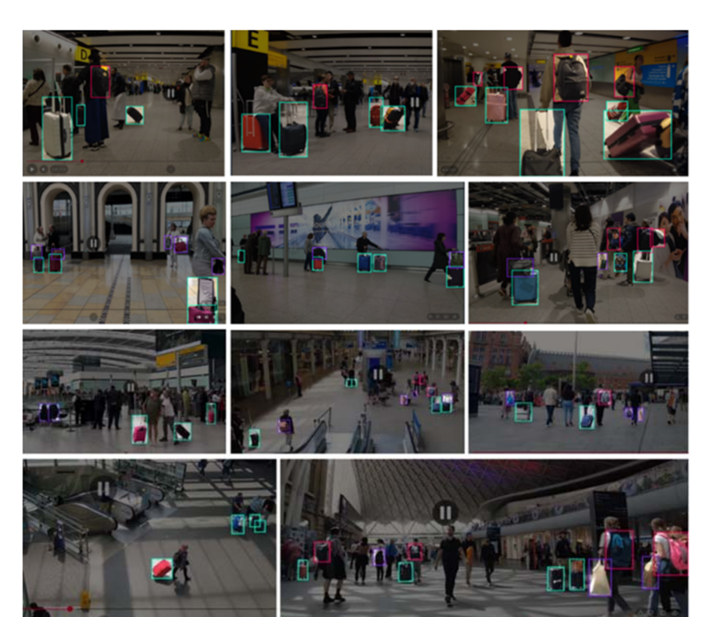
  <br/><sub><b>Figure 1.</b> Annotated frames from LuggageDataset v6i — elevated, oblique viewpoints, dense pedestrian traffic, wide illumination range, and all three classes at very different scales in one frame.</sub>
</p>

Images come from **fixed or quasi-static surveillance cameras** in transport hubs and indoor public spaces. They capture the conditions the benchmark is built for: luggage occupying a small fraction of the frame, frequent occlusion of a bag by its own owner, illumination from daylit concourses to artificially lit interiors and screen-lit walls. **No augmentation is applied anywhere** — every number in this repository is obtained on unmodified imagery. Every image is labelled; there are no background-only images and no missing label files.

### 2.1 Composition

| Split | Images | Instances | Boxes / image | Backpack | Bag | Trolley |
|---|---:|---:|---:|---:|---:|---:|
| Train | 9,138 (75%) | 41,823 (72.3%) | 4.58 | 11,338 (27.1%) | 9,268 (22.2%) | 21,217 (50.7%) |
| Validation | 1,827 (15%) | 9,819 (17.0%) | 5.37 | 2,623 (26.7%) | 1,994 (20.3%) | 5,202 (53.0%) |
| Test | 1,219 (10%) | 6,172 (10.7%) | 5.06 | 1,648 (26.7%) | 1,330 (21.6%) | 3,194 (51.8%) |
| **Total** | **12,184** | **57,814** | **4.75** | | | |

Class proportions agree across splits to within 1.9%. The dominant resolution is **640×360** (80.4% of training images), reflecting fixed-camera framing rather than a photographic mixture.

### 2.2 Object size and shape

The mean box measures **39×55 px** in a 640-px frame — **0.53%** of the image area. Size by **maximum box side** (32 / 64 px), the quantity that decides how many stride-8 cells — and therefore anchors — a box spans:

| | Small (< 32) | Medium (32–64) | Large (> 64) |
|---|---:|---:|---:|
| Train | 14,959 (35.8%) | 16,398 (39.2%) | 10,466 (25.0%) |
| Validation | 3,669 (37.4%) | 4,034 (41.1%) | 2,116 (21.6%) |
| Test | 2,175 (35.2%) | 2,510 (40.7%) | 1,487 (24.1%) |
| *backpack (train)* | 3,699 (32.6%) | 4,600 (40.6%) | 3,039 (26.8%) |
| *bag (train)* | 3,499 (37.8%) | 3,267 (35.3%) | 2,502 (27.0%) |
| *trolley (train)* | 7,761 (36.6%) | 8,531 (40.2%) | 4,925 (23.2%) |

Per-class shape (training split; wide h/w < 0.8, tall h/w > 1.25):

| Class | n | Mean h/w | Wide | Square | Tall |
|---|---:|---:|---:|---:|---:|
| backpack | 11,338 | 1.47 | 1.2% | 23.8% | 74.9% |
| bag | 9,268 | 1.33 | **13.2%** | 36.0% | 50.8% |
| trolley | 21,217 | 1.68 | 5.5% | 17.6% | **76.9%** |

> **Bag is the hard class by construction.** It holds 48.5% of every wide box while being only 22.2% of instances, it is the only class with balanced shape bins, and it has the most bimodal size distribution (highest large share, lowest medium share). It is semantically loose — handbags, duffel bags, shopping bags, plastic bags — and it is the hardest class to detect at every size on both detectors.

Two size conventions are used and never mixed: dataset statistics and assignment diagnostics bin by **maximum side** at 32/64 px; detection metrics bin by **area** at the COCO edges 32² / 96² px², because that is what the evaluator computes. A 25×100 px trolley is *large* by side but *medium* by area.

Unlike the closest public alternative, the dataset is **not devoid of large objects** (25% of training instances exceed 64 px), so it can show whether a small-object method gains by sacrificing large ones.

### 2.3 Leakage-free split

Consecutive surveillance frames are near-identical: the camera is fixed and the same suitcase appears in hundreds of images that differ only by pedestrian motion. A split that assigns frames independently places the same scene in training and test, and the reported accuracy partly measures memorization — invisible in the usual sanity checks, because class proportions and size distributions still look correct. A memorizing baseline would also leave less headroom, so a per-frame split would make **every mechanism look less helpful**.

<p align="center">
  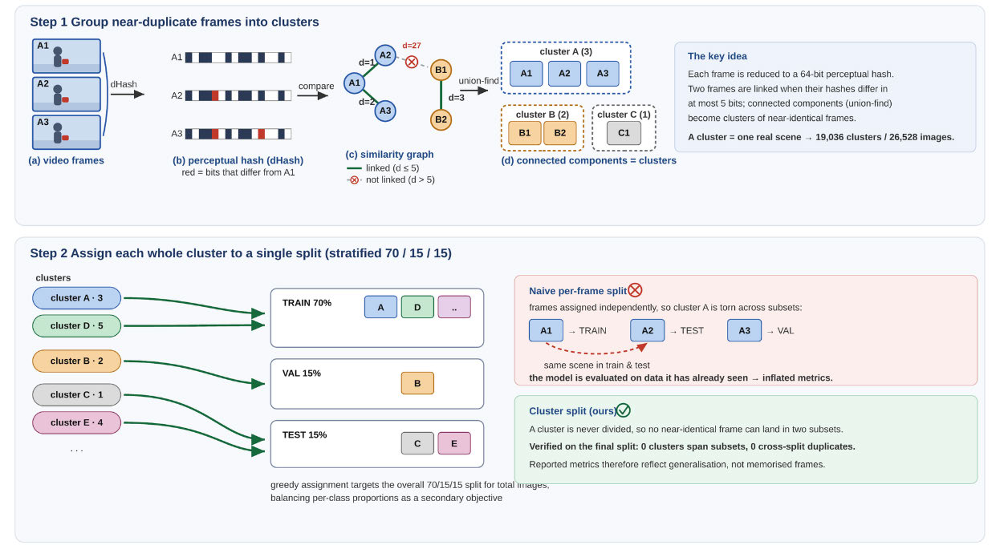
  <br/><sub><b>Figure 2.</b> The leakage-free splitting procedure. Step 1: each frame is reduced to a 64-bit difference hash; frames whose hashes differ in at most five bits are linked, and union-find groups them into clusters, one cluster per real scene. Step 2: each whole cluster is assigned to one split by a stratified greedy procedure, so no near-duplicate frame can cross a split boundary.</sub>
</p>

The threshold of 5 bits is small enough to keep visually distinct scenes apart and large enough to catch frames that differ only by compression noise and small motion. Because no cluster is ever divided, no near-duplicate frame can cross a split boundary *by construction*. The procedure is the one validated in our earlier work on weapon detection, applied unchanged.

**One documented drift:** the validation split contains systematically smaller boxes (35×49 px mean vs 40×56 px on test, ~23% smaller in area) and fewer large objects (21.6% vs 24.1%). All large-object results are therefore reported on **test only**.

### 2.4 Comparison with existing benchmarks

| Dataset | Content | Size | Annotations | Event labels | Availability |
|---|---|---|---|:---:|---|
| PETS 2006 | railway station, 4 views | 7 sequences | trigger frames + calibration | ✓ | host offline |
| i-LIDS AVSS 2007 | metro platform, 1 view | 3 sequences | one event per sequence | ✓ | 3 of 8 clips |
| ABODA | indoor / outdoor / night / light switch | 11 videos | none | ✓ | GitHub |
| IITP20 | 58 videos, 3 difficulty tiers | 58 videos | folder-level only | — | label errors |
| CCTV-KD | airport + walkway, bird's-eye | ~300 images | 2,760 luggage / 6,414 persons | — | GitHub + Roboflow |
| **LuggageDataset v6i** | **fixed-camera public spaces** | **12,184 images** | **57,814 luggage, 3 classes** | — | **released** |

Against CCTV-KD, v6i provides **~21× the luggage annotations** (57,814 vs 2,760) from **~40× the distinct source images** (12,184 vs ~300), on three classes instead of one. CCTV-KD has person annotations and denser scenes (~20 objects per image vs 4.75), which we state openly. Neither dataset contains abandonment events: v6i is a **detection** benchmark and complements event benchmarks such as ABODA.

---

## 3. Method

### 3.1 Design rule: start from the baseline, exactly

Both detectors are modified along two axes — **loss/assignment** and **architecture** — under one rule: *at initialization the modified model must reproduce the pretrained baseline exactly*. Every new block is a residual branch with a zero-initialized, per-channel gate

```math
y = x + \gamma \odot \mathcal{F}(x), \qquad \gamma\big|_{t=0} = 0,
```

and every loss change reduces to the original objective at its default value. Pretrained weights therefore transfer without loss, and any difference in the final metric is attributable to the mechanism, not to a different initialization.

### 3.2 Why the two detectors are treated differently

On paper their objectives are identical — BCE classification, CIoU box regression, a task-aligned assigner with α = 0.5 and β = 6, loss gains box = 7.5, cls = 0.5, dfl = 1.5. Three implementation details, invisible in the training configuration, make them behave differently:

| | YOLOv12s | YOLO26s |
|---|---|---|
| Box distribution | DFL, `reg_max = 16` | none, `reg_max = 1` |
| Third loss term | DFL over 16 bins | L1 on left/top/right/bottom distances ÷ image size |
| Assignment | one-to-many, k = 10 (+ NMS at inference) | **two** branches: o2m k = 10, o2o k = 7 → k₂ = 1 |
| Branch weighting | — | o2m 0.8 → 0.1, o2o 0.2 → 0.9 over training |
| Duplicate removal | NMS | argmax, **no NMS** |

### 3.3 Curriculum area weighting (YOLOv12s)

After assignment, the regression loss sums over positives weighted by their target score. Two things work against small objects at once: a large box collects more positives (9.79 vs 7.73 per ground truth, from a candidate pool 51× larger), and its IoU is *smoothly* informative, while for a 12×18 px bag a few pixels move IoU by tens of points. The optimizer fits the quiet, reliable large-object signal first and averages small objects away.

Each positive *j* is re-weighted by the inverse **linear** size of its box, on a schedule:

```math
w_j^{(t)} = \alpha(t)\,\hat{a}_j + \bigl(1-\alpha(t)\bigr)\,s_j,
\qquad
a_j = A_j^{-1/2},\quad
\hat a_j = \frac{a_j}{\max_{k \in \mathcal{P}} a_k}\, b_j,
```

```math
b_j = \begin{cases} \rho, & \sqrt{A_j}\,\sigma_j < p_{\text{small}} \\ 1, & \text{otherwise} \end{cases},
\qquad
\alpha(t) = \mathrm{clip}\Bigl(\alpha_{\text{s}}\,(1 - t/T) + \alpha_{\text{e}}\, t/T,\ \alpha_{\min},\ \alpha_{\max}\Bigr)
```

where $s_j$ is the summed target score, $A_j$ the box area in feature units at its level, and $\sigma_j$ that level's stride. Training starts **scale-dominant** and ends **score-balanced**, so the final epochs optimize the objective the model is evaluated on. The weight multiplies the CIoU and DFL terms; classification is untouched. Selected: $\alpha_\text{s}=0.7$, $\alpha_\text{e}=0.3$, $p_\text{small}=32$ px, $\rho=2.0$.

*Why $A^{-1/2}$ and not $A^{-1}$:* box areas span three orders of magnitude; $1/A$ lets the smallest instances dominate the batch and destabilizes training, while $A^{-1/2}$ scales with linear size and keeps the ratio bounded. Both were implemented — the square root was better.

### 3.4 Flattened task-alignment exponent (YOLO26s)

The task-aligned assigner scores every (ground truth, anchor) pair and builds the classification target from that score:

```math
m_{ij} = s_{ij}^{\,\alpha}\cdot u_{ij}^{\,\beta},
\qquad
\hat{t}_{ij} = \frac{m_{ij}\,\max_{j' \in \mathcal{P}_i} u_{ij'}}{\max_{j' \in \mathcal{P}_i} m_{ij'} + \epsilon}
```

The metric acts at three points: **selection** of the top-k anchors, **tie-break** in the one-to-one branch, and **target magnitude**. Consider two anchors with IoU 0.80 and 0.70. Raised to the sixth power they become 0.262 and 0.118 — a factor of 2.2. On a large box that gap is a real difference in localization; on a 12×18 px bag one pixel of displacement moves IoU by several points, so the same gap is mostly sampling noise, yet β = 6 amplifies it into confident distinctions and propagates them into the classification target.

**Modification: β 6 → 1** (selected from nine values in [0, 6]). The ranking is preserved — better-localized anchors still win — but margins are compressed. The prediction is specific: help where IoU is noisiest (small objects), cost slightly on mAP@50-95, the metric that rewards fine localization. Both are observed.

### 3.5 Anchor supply — the bound on any loss change

Both loss mechanisms act on assignments that already exist. The number of anchor centers inside a w×h box at stride *s* is

```math
n(s) = \Bigl[\lfloor x_2/s - \tfrac12 \rfloor - \lceil x_1/s - \tfrac12 \rceil + 1\Bigr]_+ \cdot \Bigl[\lfloor y_2/s - \tfrac12 \rfloor - \lceil y_1/s - \tfrac12 \rceil + 1\Bigr]_+
```

Measured on the training labels:

| | Candidate centers | Positives | Budget k |
|---|---:|---:|---:|
| Small object | **12.90** (9.82 at stride 8, 2.46 at 16, 0.62 at 32) | 7.73 (60% of its pool) | 10 |
| Large object | 657.67 (51× more) | 9.79 | 10 |

The budget is **almost non-binding** for small objects: 38–42% of them hold fewer than k centers, rising to ~70% under mosaic augmentation. For those, every candidate is already a positive and no ranking change can alter the assignment. **Adding a stride-4 level raises a small object's pool to ~52 centers** — which motivates the architectural axis. At stride 32, small objects draw 0.01 positives per ground truth: the coarsest level does very little work on this dataset.

### 3.6 Architecture

<p align="center">
  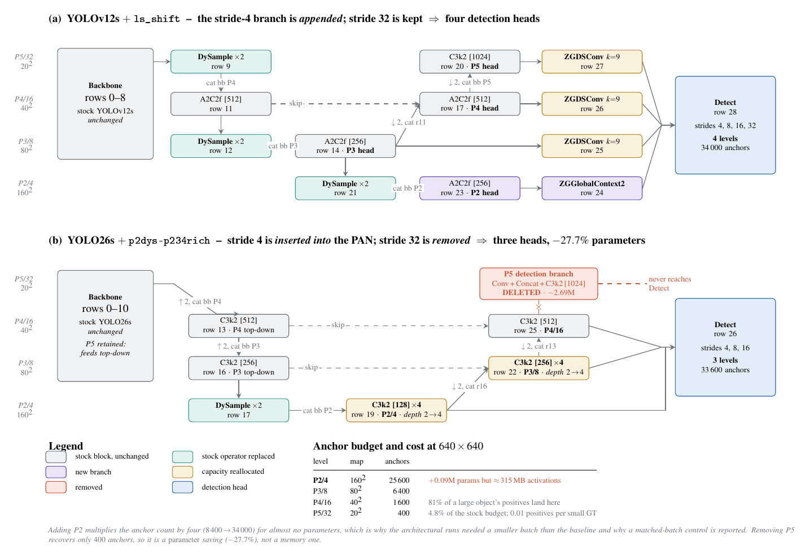
  <br/><sub><b>Figure 3.</b> The two architectural modifications. (a) YOLOv12s: a stride-4 branch is <i>appended</i>, giving four detection heads, each with one gated refinement block. (b) YOLO26s: the stride-4 branch is <i>inserted</i> into the PAN, the stride-32 detection branch is removed and the two finest levels are deepened. Every colored block is gated, so both networks start as their pretrained baseline.</sub>
</p>

**Shared: a stride-4 (P2) detection level** at 160×160, fused from the finest pyramid level and the stride-4 backbone feature — the only change that creates positives where no anchor existed. It adds only **0.09 M parameters** but ~315 MB of activations at batch 48, and raises anchors from 8,400 to 34,000.

**Content-aware upsampling (DySample)** replaces nearest-neighbor interpolation on the top-down path, predicting per-location sampling offsets:

```math
y_p = x\bigl(p/\rho + \Delta_p\bigr), \qquad \Delta_p = \tfrac{1}{2}\,\sigma\bigl(\mathcal{S}(x)\bigr) \odot \mathcal{O}(x) + p_0
```

with the scope branch zero-initialized and the offsets near zero, so upsampling starts as bilinear.

<table>
<tr>
<th width="50%">YOLOv12s — level-specific refinement</th>
<th width="50%">YOLO26s — level reallocation</th>
</tr>
<tr>
<td valign="top">

- P2 branch **appended**; rows 9–20 of the stock graph untouched, so pretrained neck weights stay aligned by name
- **Stride 4:** gated global context from average **and** max pooling — a 12-px dark blob is a bag, a shadow or a bin depending on its surroundings, and max pooling keeps the single salient activation that averaging erases

```math
\mathcal{F}(x) = \mathrm{MLP}\bigl([\,\bar{x}\,;\,\max_{H,W} x\,]\bigr)
```

- **Strides 8/16/32:** gated **dynamic snake convolution** (k = 9) whose taps accumulate offsets outward from the center, tracing the tall, oriented shape of trolleys (70.6% of boxes are tall)
- Applying either block at every level was tested and was worse than the split

</td>
<td valign="top">

- P2 branch **inserted** into the PAN — the bottom-up path is rebuilt through it, so stride-4 features inform the coarser predictions
- **Stride-32 detection branch removed**, stride-32 *backbone* retained: the top-down path still gets scene-wide context; only the vestigial predictions go
- Freed capacity **returned to the finest levels**: block repeats 2 → 4 at strides 4 and 8, where 75% of instances live
- **9.68 M → 6.99 M parameters (−27.7%)** while becoming deeper where it matters
- Repeat count 6 was inferior on every metric: 4 is a bracketed optimum, not the end of a trend

</td>
</tr>
</table>

### 3.7 Hyperparameter search

| Parameter | Interval | Values trained | Selected |
|---|---|---:|---|
| *Loss — curriculum weighting (YOLOv12s)* | | | |
| $\alpha_\text{s}$ (start) | [0.6, 0.9] | 7 | 0.7 |
| $\alpha_\text{e}$ (end) | [0.3, 0.5] | 4 | 0.3 |
| area exponent | {A⁻¹, A⁻³ᐟ⁴, A⁻¹ᐟ²} | 3 | A⁻¹ᐟ² |
| $p_\text{small}$ (px) | [24, 36] | 5 | 32 |
| ρ (boost) | [1.0, 2.5] | 7 | 2.0 |
| *Loss — task alignment (YOLO26s)* | | | |
| β | [0, 6] | 9 | 1.0 |
| α | [0.25, 1.0] | 6 | 0.5 (default) |
| β split (selection / target) | [1, 6] | 6 | not adopted |
| β size-conditional | [1.5, 3.0] | 5 | not adopted |
| k (top-k) | {7, 10, 12, 14} | 4 | default |
| *Architecture* | | | |
| P2 / P3 block repeats | {2, …, 6} | 5 | 4 |
| snake kernel k | {3, 5, 7, 9} | 4 | 9 |
| detection levels | {3, 4} | 2 | per detector |

The β surface is flat over [0, 3] (spread below the noise floor): the gain for β = 1 should be read as "any value well below the default 6" rather than a tuned optimum.

The loss grids and the architecture sweep are provided as runnable scripts — see [§12.3](#123-sweeps).

---

## 4. Experimental protocol

| | |
|---|---|
| Training | 70 epochs, 640×640, official pretrained checkpoints, mosaic disabled for the last 10 epochs |
| Seeds | **3** per reported configuration (mean ± std) |
| Evaluation | full leakage-free test split — 1,219 images, 6,172 instances |
| Checkpoint | best validation mAP (never lowest loss) |
| Hardware | NVIDIA RTX 4090 (24 GB), Intel Core i9-13900KF, 64 GB DDR5, CUDA 12.1, PyTorch |
| Search | 226 runs across both detectors, 14 loss and label-assignment mechanisms, a systematic architectural sweep |

**Verification.** Every run asserts its own configuration at training time: the mechanism is read back from the live loss object, the fraction of transferred pretrained parameters is measured (the run aborts below a threshold), and every mechanism not under test is passed explicitly in its *off* state.

**Noise floor.** Run-to-run variability is measured, not assumed:

```math
\mathrm{SE} = \sigma\sqrt{\tfrac{2}{n}} \ \ \text{(n-seed mean vs n-seed mean)},
\qquad
\mathrm{SE} = \sigma\sqrt{1 + \tfrac{1}{n}} \ \ \text{(single run vs mean)}
```

The pooled within-configuration σ is **0.34%** (YOLO26s) and **0.25%** (YOLOv12s), with 8 degrees of freedom, so two three-seed means differ by SE = **0.28%** and **0.20%**. A difference is *resolved* above 2 SE (0.56% / 0.40%).

**Selection bias.** Re-running a configuration that had won an exploratory round regressed by **−0.55%** on average across seven repeats, and no repeat exceeded its original draw. Single-draw maxima are therefore never reported as results.

---

## 5. Results

### 5.1 Main results (mean ± std over three seeds)

<table>
<tr><th rowspan="2">Metric</th><th colspan="5">YOLO26s</th><th colspan="5">YOLOv12s</th></tr>
<tr><th>Base</th><th>Loss</th><th>Arch</th><th>A+L</th><th>Δ</th><th>Base</th><th>Loss</th><th>Arch</th><th>A+L</th><th>Δ</th></tr>
<tr><td><b>mAP@50 small</b></td><td>77.26 ±0.23</td><td>78.61 ±0.46</td><td>79.83 ±0.16</td><td><b>79.91 ±0.42</b></td><td><b>+3.44</b></td><td>77.65 ±0.15</td><td>77.93 ±0.26</td><td>78.79 ±0.27</td><td><b>79.87 ±0.29</b></td><td><b>+2.85</b></td></tr>
<tr><td>mAP@50</td><td>80.25 ±0.29</td><td>81.45 ±0.30</td><td>82.37 ±0.21</td><td>83.01 ±0.39</td><td>+3.45</td><td>80.72 ±0.20</td><td>81.21 ±0.12</td><td>82.12 ±0.25</td><td>82.60 ±0.21</td><td>+2.32</td></tr>
<tr><td>mAP@50-95</td><td>54.90 ±0.18</td><td>54.71 ±0.19</td><td>56.61 ±0.23</td><td>56.43 ±0.18</td><td>+2.79</td><td>54.75 ±0.15</td><td>54.55 ±0.05</td><td>56.42 ±0.07</td><td>56.09 ±0.21</td><td>+2.44</td></tr>
<tr><td>Precision</td><td>81.28 ±0.32</td><td>82.21 ±0.11</td><td>83.26 ±0.25</td><td>84.00 ±0.31</td><td>+3.35</td><td>80.60 ±0.30</td><td>81.96 ±0.41</td><td>83.12 ±0.17</td><td>83.00 ±0.29</td><td>+2.97</td></tr>
<tr><td>Recall</td><td>72.79 ±0.19</td><td>74.01 ±0.11</td><td>75.98 ±0.31</td><td>75.89 ±0.31</td><td>+4.25</td><td>72.23 ±0.42</td><td>73.78 ±0.19</td><td>74.11 ±0.37</td><td>74.94 ±0.39</td><td>+3.76</td></tr>
<tr><td>F1</td><td>76.80 ±0.25</td><td>77.89 ±0.11</td><td>79.46 ±0.28</td><td>79.74 ±0.24</td><td>+3.82</td><td>76.18 ±0.27</td><td>77.66 ±0.08</td><td>78.36 ±0.28</td><td>78.76 ±0.35</td><td>+3.39</td></tr>
</table>

<sub>Loss = loss/assignment change only · Arch = architectural change only · A+L = both · Δ = percentage gain of A+L over the baseline.</sub>

- The combined configuration is best on the primary metric for **both** detectors, and the headline gains are **9.5 SE** (YOLO26s) and **11.0 SE** (YOLOv12s) — far above the noise floor.
- The loss axis alone **trades localization for detection**: mAP@50-95 falls by 0.35% (YOLO26s) and 0.37% (YOLOv12s). The architecture improves both.

### 5.2 Training dynamics

<p align="center">
  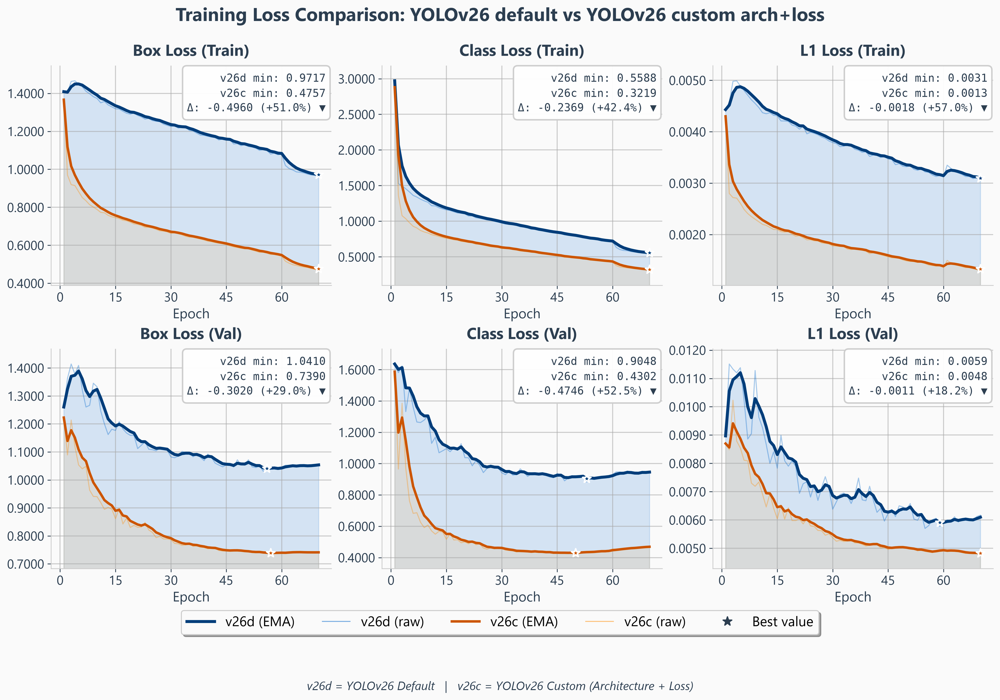
  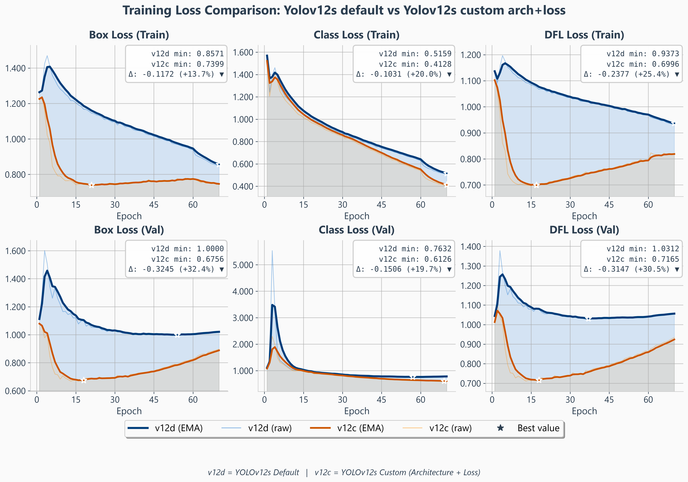
  <br/><sub><b>Figures 6–7.</b> Loss components, baseline vs custom — YOLO26s (left, third term is the L1 surrogate) and YOLOv12s (right, a genuine 16-bin DFL).</sub>
</p>

The two detectors overfit in different terms and on different timescales. On **YOLO26s** both regression terms fall for essentially the whole schedule (validation box minimum at epoch 57, L1 at 60). On **YOLOv12s** the validation box and DFL losses bottom out near **epoch 18** and climb for the remaining fifty epochs while mAP@50 keeps improving until ~epoch 60 — the regression head overfits long before the detector stops gaining. This is why checkpoints are always selected on validation mAP, never on loss.

### 5.3 Performance by object size

| | | **YOLO26s** | | | | | **YOLOv12s** | | | | |
|---|---|---:|---:|---:|---:|---:|---:|---:|---:|---:|---:|
| **Size** | **Metric** | Base | L | A | A+L | Δ | Base | L | A | A+L | Δ |
| **Small** (< 32²) | mAP@50 | 77.26 | 78.61 | 79.83 | 79.91 | **+3.44** | 77.65 | 77.93 | 78.79 | 79.87 | **+2.85** |
| | mAP@50-95 | 50.64 | 50.50 | 52.85 | 52.82 | +4.31 | 49.88 | 49.66 | 51.65 | 51.60 | +3.45 |
| | Precision | 77.31 | 78.25 | 80.06 | 80.97 | +4.73 | 76.81 | 79.08 | 81.07 | 80.06 | +4.24 |
| | Recall | 72.10 | 72.59 | 74.57 | 74.20 | +2.91 | 70.29 | 71.16 | 71.25 | 73.67 | +4.82 |
| | F1 | 74.62 | 75.32 | 77.22 | 77.44 | +3.78 | 73.40 | 74.91 | 75.85 | 76.74 | +4.54 |
| **Medium** (32²–96²) | mAP@50 | 86.60 | 87.26 | 87.28 | 88.59 | +2.30 | 87.65 | 87.54 | 87.78 | 87.42 | −0.26 |
| | mAP@50-95 | 65.46 | 65.38 | 66.08 | 66.16 | +1.07 | 65.12 | 64.46 | 65.65 | 64.49 | −0.98 |
| | F1 | 84.90 | 85.36 | 86.75 | 87.29 | +2.82 | 84.41 | 85.13 | 85.99 | 85.20 | +0.93 |
| **Large** (> 96²) | mAP@50 | 81.82 | 81.85 | 83.26 | 80.83 | −1.21 | 82.93 | 82.63 | 84.68 | 82.79 | −0.17 |
| | mAP@50-95 | 60.54 | 59.87 | 60.84 | 59.49 | −1.73 | 57.62 | 58.67 | 60.52 | 59.90 | +3.94 |
| | F1 | 78.13 | 79.81 | 84.01 | 79.02 | +1.14 | 79.11 | 81.74 | 82.80 | 80.58 | +1.86 |

- **Gains concentrate on small objects**, which together with medium objects make up 75% of instances.
- **Same F1 gain, different route:** YOLO26s gets there by becoming more *selective* (small-object precision +4.73%, recall +2.91%) — the trace of one-to-one assignment; YOLOv12s by *finding more objects* (precision +4.24% and recall +4.82% together) — the trace of NMS.
- **The large-object cost belongs to the combination, not the architecture.** Alone, the architecture keeps large-object mAP@50-95 on YOLO26s (+0.51%) and improves it markedly on YOLOv12s (+5.03%); adding the loss axis on top gives back 2.43 (YOLO26s) and 1.89 (YOLOv12s) points of large-object mAP@50.
- **Why no per-cell maxima.** Each column is one configuration evaluated at all sizes. Picking the best of N = 174 YOLO26s runs on large-object mAP@50 (σ = 2.258) is expected to exceed the mean by ~7.25% from noise alone — more than the 5.20% gap to the campaign maximum. Reporting per-cell maxima would tabulate selection bias.

### 5.4 Per-class behavior

<p align="center">
  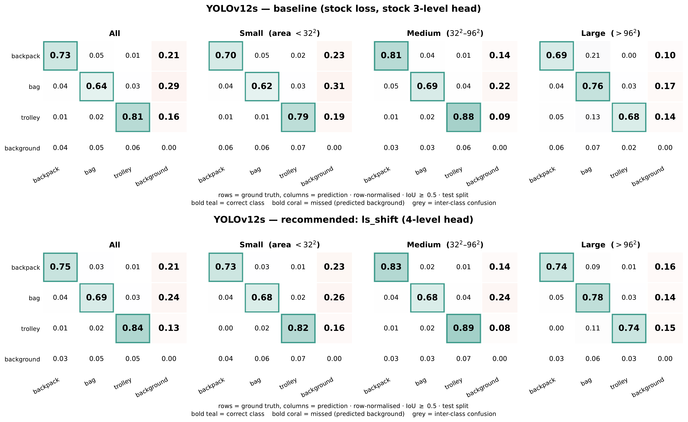
  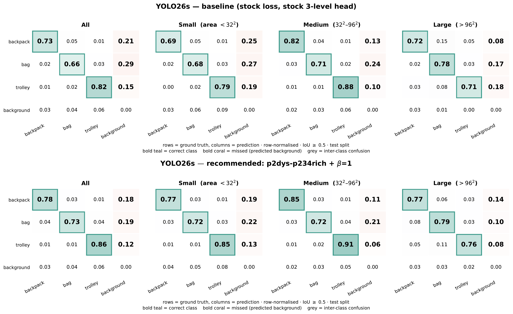
  <br/><sub><b>Figures 8–9.</b> Row-normalized confusion matrices on the test split, for all objects and per size: YOLOv12s (left) and YOLO26s (right), baseline on top, custom below.</sub>
</p>

**Bag is the hardest class at every size, on both detectors, by a wide margin** — small-object AP@50 of 68.4% (YOLO26s) and 66.8% (YOLOv12s) against 85.7% and 86.5% for trolley. The assignment diagnostics show per-class behavior essentially uniform at strides 8 and 16, so the deficit is **not** a matter of anchor supply and cannot be repaired by a stride-4 level or an assignment exponent: it is a classification problem. Both custom models improve it slightly (+0.98 and +1.76 on small objects) without changing its rank. The large-object cost on YOLO26s is concentrated almost entirely in the bag class (AP@50-95 68.36 → 60.84), while backpack loses 2.09 and trolley 1.37.

### 5.5 Cross-detector transfer: nothing transfers

Each modification evaluated on the detector it was developed for (*own*) and on the other one (*other*) — change in small-object mAP@50 over that detector's baseline; changes below ~0.7% of the baseline (2 SE) are not resolvable:

| Axis | Modification | Own | Other |
|---|---|---:|---:|
| Loss | Curriculum area weighting (YOLOv12s) | +0.36 | null |
| Loss | Alignment exponent β = 1 (YOLO26s) | **+1.75** | +0.32 |
| Architecture | Level-specific blocks (YOLOv12s) | **+1.47** | +0.66 |
| Architecture | Drop stride 32 + depth 4 (YOLO26s) | **+3.33** | +0.56 |

Every one of the four transfers is null on the primary metric, and two do damage that metric hides: the YOLO26s level reallocation costs YOLOv12s **6.1%** of large-object mAP@50 (9.6% at strict IoU), and β = 1 costs YOLOv12s 0.9% of mAP@50-95. The *mechanism signatures* transfer faithfully; the *net benefits* do not. Each failure traces back to the implementation table of §3.2:

- **Area weighting needs a DFL.** On YOLOv12s the weight multiplies a DFL that is anchor-relative and scale-free, so re-weighting by object scale genuinely redistributes gradient. YOLO26s substitutes an image-normalized L1 term with constant gradient magnitude regardless of box size — a scale-relative weighting has little to redistribute in a scale-absolute loss.
- **β matters only without NMS.** On YOLOv12s a small object holds ~7.7 positives and NMS pools their predictions — it launders a noisy ranking. YOLO26s's one-to-one branch picks exactly one anchor by argmax, with no NMS to revise it, and its weight rises from 0.2 to 0.9 over training, so β's choices dominate exactly when the decision boundary is set. The precision/recall exchange appears in **95%** of qualifying YOLO26s configurations and only **37%** of YOLOv12s ones.
- **Removing stride 32 hurts YOLOv12s large objects.** A YOLOv12s anchor expresses each edge as a 16-bin distribution in feature cells, so a stride-16 anchor reaches at most 16 × 16 = 256 px; stride 32 reaches 512. YOLO26s regresses offsets directly and has no such range limit. (Our leading hypothesis, consistent with the sharp loss at strict IoU.)
- **Global context needs a selection stage to pay off.** The YOLOv12s global-context block, ported to YOLO26s, scored +0.51 on the stock graph and +0.01 once P2 + DySample were present — below the shared change it was added to.

> **Practical consequence.** A small-object mechanism validated on one detector should not be expected to carry to another — even one from the same family, trained on the same images at the same resolution. Our two detectors differ by one release generation and share a configuration format, and yet nothing transferred. The cost of checking is one additional detector.

### 5.6 Inference speed

RTX 4090, batch 1, 640×640, FP16, median over 500 test images, pre- and post-processing included:

| Model | GFLOPs | Latency | FPS |
|---|---:|---:|---:|
| YOLOv12s baseline | 19.3 | 4.05 ms | 247 |
| YOLOv12s custom | 32.1 | 8.32 ms | 120 |
| YOLO26s baseline | 20.5 | 2.93 ms | 341 |
| **YOLO26s custom** | **23.5** | **3.39 ms** | **295** |

The custom YOLO26s adds only 15% compute (the stride-4 level is partly paid for by the removed stride-32 branch); the custom YOLOv12s roughly halves the frame rate. On four of the evaluation clips (5,683 frames, 640×480 to 720×576 px), the YOLOv12s luggage detector runs at 227 / 116 FPS (baseline / custom), or **202 / 109 FPS including video decoding** — even the slowest detector in the study is **3.5–3.9× faster than real time**.

> **Best trade-off: custom YOLO26s** — the same small-object accuracy as the custom YOLOv12s (79.91 vs 79.87 mAP@50) at **~2.5× its frame rate** and 27.7% fewer parameters.

---

## 6. Unattended-luggage pipeline

<p align="center">
  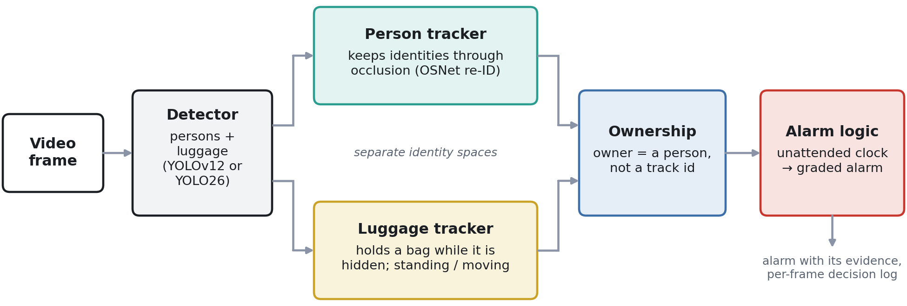
  <br/><sub><b>Figure 4.</b> A YOLOv12 or YOLO26 detector provides person and luggage boxes in every frame, tracked in separate identity spaces. The ownership stage binds each bag to a <i>person</i> rather than to a track number, and the alarm logic runs one dwell clock per bag. Every decision is written to a per-frame log, so a raised alarm can be replayed against the evidence that produced it. Only the luggage detector is fine-tuned; the person detector is a pre-trained COCO model.</sub>
</p>

The alarm rule is the conventional one — a bag becomes unattended when its owner is farther than a threshold and raises an alarm after a dwell time. What makes it work in a crowd is **keeping the identities it depends on**: nearly every failure we observed was a person re-born under a new number after an occlusion, a number handed to a passer-by, or a bag given to a bystander. The pipeline is built around one question: *which physical person is this, and is it still the owner?*

All timers run on **video time** (1/fps per frame), so every run is exactly reproducible, and all distances are in **person-heights *h*** — the pixel distance between a person's feet and the base of the object, divided by that person's box height. Since a box height is the image size of a ~1.7 m person at that spot, **1 h ≈ 1.7 m anywhere in the image** and one threshold holds near and far from the camera.

### 6.1 Keeping person identities

<p align="center">
  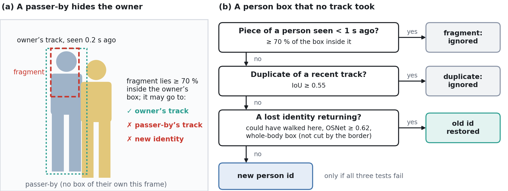
  <br/><sub><b>Figure 5.</b> (a) A passer-by hides a person and only a fragment of the hidden person is detected; the fragment lies inside that person's recent box, so only their track may take it. (b) A box that no track took must fail three tests before it becomes a new person.</sub>
</p>

- Boxes are matched to tracks **in order of certainty** — mutual best overlaps first, then Hungarian assignment by recency, under tight distance and size gates.
- **Weak detections** (confidence ≥ 0.10) may keep a track alive but never start one.
- **Fragment rule** — a box lying ≥ 70% inside a person seen in the last second goes only to that person (most identity swaps come from head-and-shoulders boxes during crossings).
- **Lost identities** are recovered for up to 26 s with **OSNet** embeddings (AUC 0.92 on the footage, against 0.75 for a color histogram); border-cut boxes may never revive an identity.

### 6.2 Ownership: the owner is a person, not a track number

Standing near a bag is weak evidence in a crowd; **walking with it is strong evidence**. For every person–bag pair the pipeline accumulates an ownership score

```math
E_p \leftarrow E_p\,e^{-\Delta t/30\,\mathrm{s}} + \Delta t\Bigl[\mathbf{1}(d_p \le 1.5h)\Bigl(1 - \frac{d_p}{3h}\Bigr) + 5\cos\theta_p\,\mathbf{1}(\text{carrying})\Bigr]
```

where $d_p$ is the person-to-bag distance, $\theta_p$ the angle between their directions of motion, and *carrying* means the person is within 1.0 h of the moving bag, moving in the same direction (within ~45°) at a similar speed (within a factor of 2). The owner is elected after the bag's first 2 s; afterwards **only someone seen carrying the bag can take it over**. Because no tracker keeps every number on the right person, each bag also stores a description of its owner (appearance, last position, last whole-body box), used by three rules:

- **Verification** — the number holding the owner role must keep looking like the owner.
- **Split rule** — a new number appearing on the owner's last whole-body box while the old number moves away *is* the owner.
- **Newborn-only hand-over** — when the owner simply vanishes, only a number born around that moment may inherit the bag.

### 6.3 Alarm triggering

A standing bag becomes **unattended** when its owner is more than 2.5 h away, or hidden for 4 s after being seen near it. After **10 s** on the clock it raises a latched alarm. The clock runs only while the bag itself is visible. A person counted as back must stay within 2.0 h for 1.5 s before the clock resets (**confirmed return**) — until then the clock is paused, so a track number that jumps onto a passer-by for one frame cannot erase an observed departure. Each alarm carries a confidence from its evidence (bag still and visible, owner watched leaving, clear election) to rank alarms for review.

| Parameter | Value | Role |
|---|---|---|
| Owner / away / return radius | 1.5 *h* / 2.5 *h* / 2.0 *h* | candidate owner / clock starts / return must hold |
| Election / dwell / grace / return | 2 s / 10 s / 4 s / 1.5 s | owner elected / alarm / owner hidden / return confirmed |
| Fragment rule | 70% inside, < 1 s | a piece belongs to the person it lies in |
| Split rule | IoU ≥ 0.40, within 1 s | new number on the owner's last whole-body box |
| OSNet thresholds | 0.51 / 0.62 / 0.66 | re-take a track / revive an identity / move a bag |

### 6.4 Evaluation on AVSS 2007 and ABODA

Five clips — i-LIDS AVSS 2007 *medium* and *easy* (a metro platform; a man leaves a trolley) and ABODA videos 1, 9 and 10 (a corridor and a classroom; a person puts a bag down and leaves). Parameters were set by inspecting failures on the crowded medium clip (**development sequence**); the other four are **held out** and were run unchanged. Each clip was processed with four luggage detectors, with persons from the official model of the same family. ABODA carries no annotations, so an alarm counts as correct when the output video shows it on the abandoned bag *and* names the person who brought it.

**Outcome per clip** (✓ = alarm on the abandoned bag naming the right owner; a bare time = right bag, wrong owner):

| Clip | YOLOv12s official | **YOLOv12s custom** | YOLO26s official | YOLO26s custom |
|---|:---:|:---:|:---:|:---:|
| AVSS medium (dev.) | ✓ 31.9 s | ✓ **31.4 s** | 35.4 s, wrong owner | 36.5 s, wrong owner |
| AVSS easy | ✓ 29.9 s | ✓ 29.9 s | ✓ 29.9 s | ✓ 29.9 s |
| ABODA video1 | 29.8 s, wrong owner | ✓ **30.1 s** | 32.0 s, wrong owner | ✓ 29.8 s |
| ABODA video9 | ✓ 54.5 s | ✓ 54.5 s | no alarm (bag not detected) | no alarm (bag not detected) |
| ABODA video10 | ✓ 32.9 s | ✓ 32.9 s | ✓ 32.6 s | ✓ 32.6 s |
| **Alarms on the bag** | 5/5 | **5/5** | 4/5 | 4/5 |
| **Owner also correct** | 4/5 | **5/5** | 2/4 | 3/4 |
| **False alarms** | 0 | **0** | 0 | 0 |

**Share of frames (%) in which each detector found the abandoned bag while carried / the bag while unattended / its owner:**

| Clip | YOLOv12s official | **YOLOv12s custom** | YOLO26s official | YOLO26s custom |
|---|:---:|:---:|:---:|:---:|
| AVSS medium | 58 / 81 / 100 | **79 / 94 / 100** | 54 / 60 / 72 | 52 / 56 / 72 |
| AVSS easy | 100 / 100 / 100 | 100 / 100 / 100 | 100 / 100 / 100 | 100 / 100 / 100 |
| ABODA video1 | 71 / 100 / 100 | **95 / 99 / 100** | 48 / 100 / 99 | 66 / 100 / 99 |
| ABODA video9 | 74 / 100 / 100 | **91 / 100 / 100** | 35 / 0 / 97 | 38 / 0 / 97 |
| ABODA video10 | 81 / 100 / 100 | 88 / 100 / 100 | 82 / 100 / 96 | 83 / 100 / 96 |
| **All clips** | 77 / 95 / 100 | **91 / 98 / 100** | 62 / 64 / 93 | 66 / 63 / 93 |

<p align="center">
  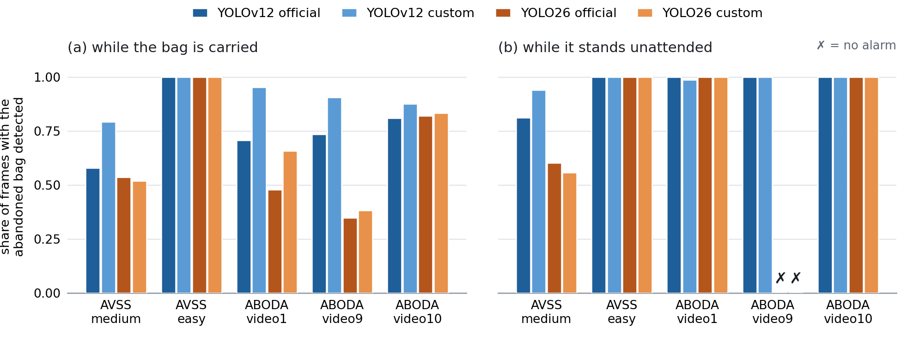
  <br/><sub><b>Figure 16.</b> Share of frames in which each detector found the abandoned bag, (a) while carried by its owner and (b) while it stands unattended (✗ = no alarm). Panel (b) decides whether the alarm fires at all; panel (a) decides whether the owner named with it is the right person.</sub>
</p>

No run raised a false alarm, and every alarm that fired was on the abandoned object. With the custom YOLOv12s the pipeline detects **all five abandonments and names the right owner in each**; on the held-out clips the alarm fires 10 s after the owner was watched leaving (AVSS) or 14 s after he left the field of view (ABODA: 4 s grace + 10 s dwell). Three conclusions follow:

1. **Whether the alarm fires is decided by detecting the standing bag.** Every run that found it in more than half of the unattended frames raised the alarm. Both YOLO26s detectors never find the bag on the table in ABODA video9 and miss the event entirely.
2. **Whether the right owner is named is decided by detecting the bag while it is carried.** The official YOLOv12s and both YOLO26s detectors find the carried bag in 62–77% of frames against **91%** for the custom YOLOv12s, which thins the carrying evidence: in video1 two of them elected the companion walking beside the owner.
3. **The tracking and ownership logic is not the limiting factor — small-luggage detection is.** The same logic that is correct on every clip with the custom YOLOv12s degrades only where the detector loses the bag. This is the practical form of the headline result: the small-object gains are what an event-level system actually consumes.

Each rule of the pipeline was added because the previous one exposed the next error. With all of them, the development-clip alarm fires at **31.4 s on the correct owner**, against 35.2 s on a drifting identity for a color-histogram re-ID baseline.

### 6.5 Clip gallery

Every figure shows the same frames processed by all four runs — top: YOLOv12s official | YOLOv12s custom; bottom: YOLO26s official | YOLO26s custom. All paper figures, with their full captions, are collected in [`docs/figures`](docs/figures).

<details open>
<summary><b>AVSS 2007 easy — all four runs agree</b></summary>
<p align="center">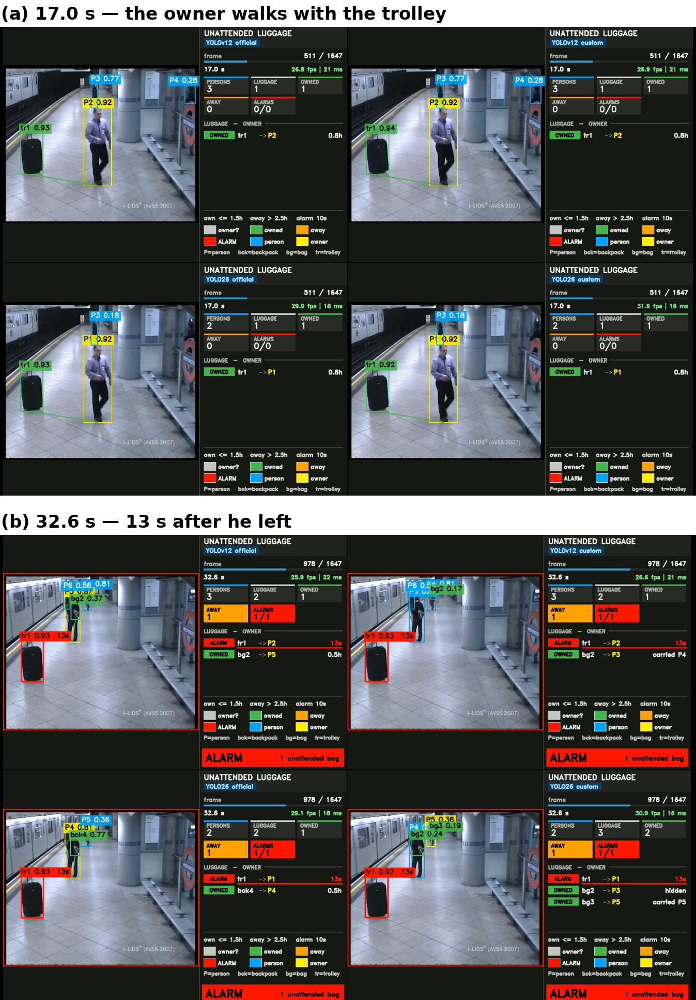</p>

(a) 17.0 s: the owner walks with the trolley and all four runs pair it with him. (b) 32.6 s, 13 s after he left: the same alarm, the same owner and practically the same clock in all four runs.
</details>

<details>
<summary><b>AVSS 2007 medium — the crowded development clip</b></summary>
<p align="center">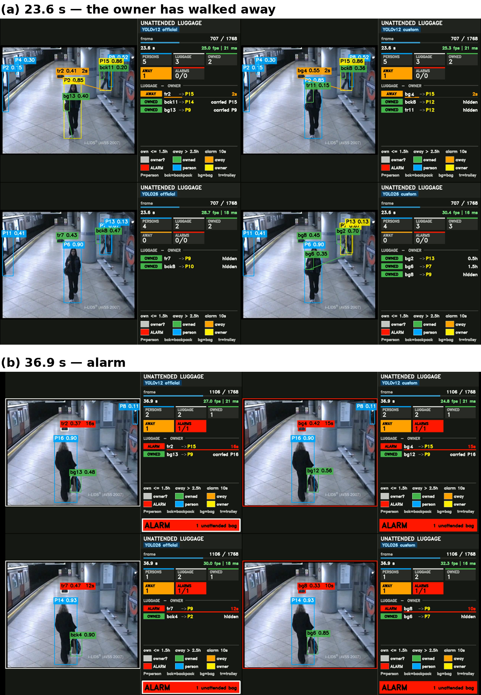</p>

(a) 23.6 s: the owner (P15) has walked away from the trolley. Both YOLOv12s runs have started the clock; both YOLO26s runs have given the trolley to a passenger (P9) who is out of view, so no clock runs at all. (b) 36.9 s: all four runs are in alarm on the trolley, but the YOLO26s runs name the passenger, and their clocks lag (12 s and 10 s against 16 s and 15 s) because the clock starts when that run's elected owner is seen leaving.
</details>

<details>
<summary><b>ABODA video1 — who carries the bag decides the owner</b></summary>
<p align="center">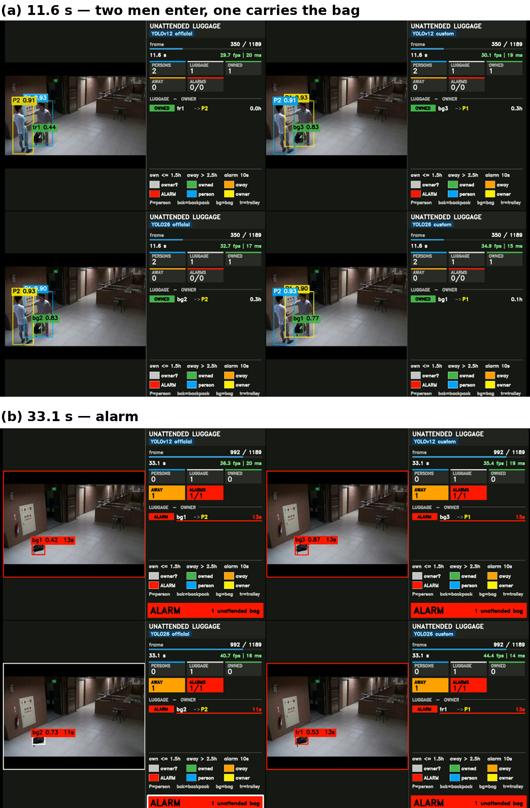</p>

(a) 11.6 s: two men enter together and one carries the bag. YOLOv12s official finds it at 0.44 and as a trolley; the two official runs elect the companion (P2), the two custom runs the man actually carrying the bag (P1). (b) 33.1 s: all four raise the alarm on the right bag, two of them naming the companion.
</details>

<details>
<summary><b>ABODA video9 — the single missed event</b></summary>
<p align="center">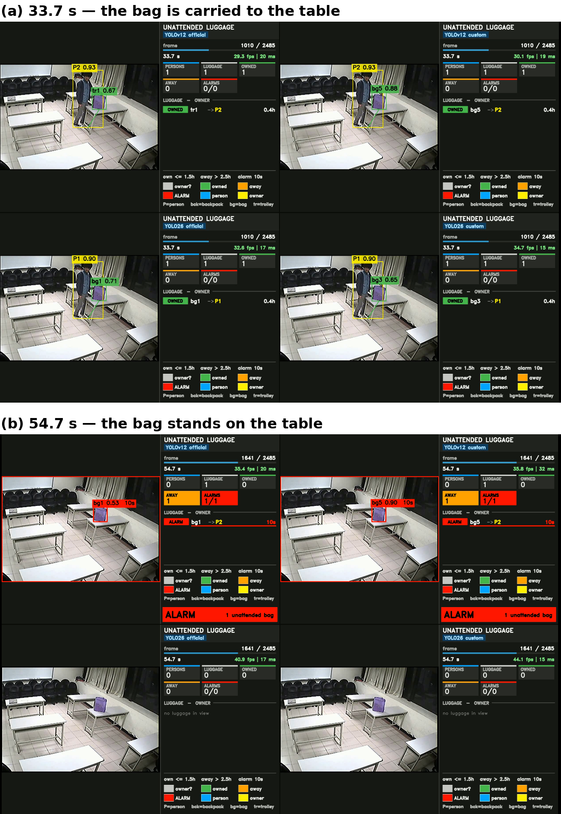</p>

(a) 33.7 s: all four runs detect the bag while its owner carries it to the table. (b) 54.7 s: both YOLOv12s runs raise the alarm; neither YOLO26s run detects the bag once it stands still on the table ("no luggage in view"), so no alarm is possible. This is a detection failure, not a logic failure.
</details>

<details>
<summary><b>ABODA video10 — a spurious detection that does not matter</b></summary>
<p align="center">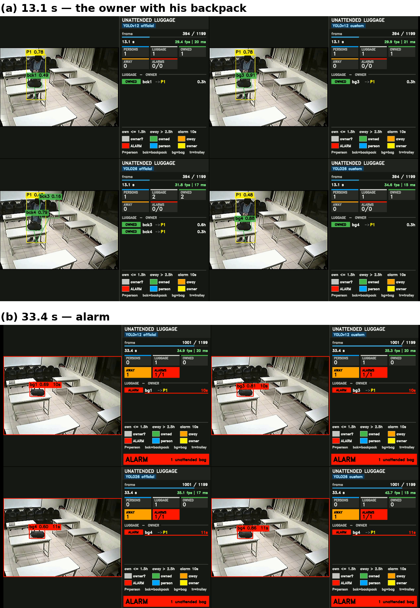</p>

(a) 13.1 s: all four runs detect the backpack and its owner; YOLO26s official adds a spurious second backpack (bck3, detected with confidence 0.16) and scores the owner at 0.48 against 0.78 for YOLOv12s. (b) 33.4 s: the same alarm, owner and clock in all four runs.
</details>

<details>
<summary><b>AVSS 2007 medium at 2.9 s — the crowd</b></summary>
<p align="center">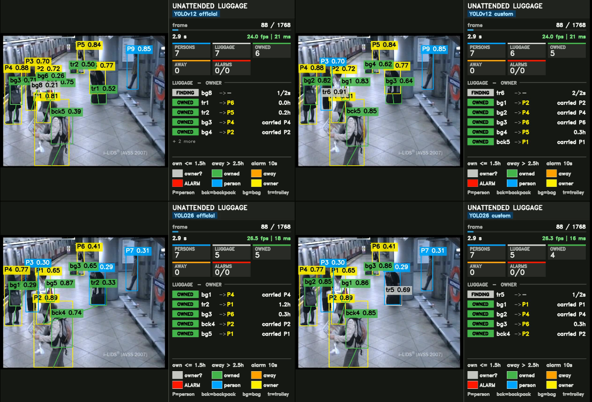</p>

The YOLOv12s detectors find 7 and 6 bags, the YOLO26s detectors 5 each, and the YOLO26s person model scores the same people lower (e.g. 0.30 against 0.70) — the mechanism behind its 72% owner-detection rate on this clip.
</details>

---

## 7. Key findings

1. **Small-object gains are real and measurable** — +3.44% (YOLO26s) and +2.85% (YOLOv12s) small-object mAP@50, at 9.5 and 11.0 standard errors above the measured noise.
2. **The two axes behave differently** — the loss/assignment change trades localization for detection; the architectural change improves both; the combination is best.
3. **Mechanisms do not transfer between detectors** — all four cross-detector transfers are null on the primary metric. The problem diagnosis was right (small objects *are* under-weighted, IoU *is* noisier at small scales, the coarsest level *does* receive few positives); the mechanism was wrong about the *detector*, because each intervention depends on a detail the configuration surface hides — the presence of a DFL, the presence of NMS, the topology of the branch it deepens.
4. **Custom YOLO26s is the best accuracy–speed trade-off** — the same small-object accuracy as custom YOLOv12s at ~2.5× the frame rate, with 27.7% fewer parameters.
5. **Detection is the bottleneck of event-level systems** — on every clip, the pipeline logic is correct wherever the detector keeps the bag; the small-object gains are exactly what it consumes.
6. **Leakage control and seeded evaluation change the picture** — without them, neither the gains nor the transfer failures could be told apart from noise and memorization.

---

## 8. Limitations

- Seeded intervals cover the four configurations per detector; the wider exploratory sweep is single-run and is reported as a search, not as evidence.
- The batch-size confound on the architectural axis is bounded but not eliminated.
- The DFL-range explanation for the YOLOv12s large-object loss is consistent with the data but untested.
- All detection results are on a single dataset; the trade-off between small-object precision and recall ceiling may be a property of bird's-eye luggage imagery rather than of small objects in general.
- The event-level evaluation rests on five clips and one development sequence; ABODA has no frame-level annotations, so its alarms are scored by inspecting the output video, and the frame-level detection rates use reference positions from the YOLOv12s custom run. A larger annotated video benchmark is needed to turn these outcomes into rates with error bars.

---

## 9. Released models

Six checkpoints are published as assets of the [**GitHub Release**](../../releases/latest) (the files are too large for git). Their test-split results are reported in the paper (§5).

| Checkpoint | Detector | Architecture | Loss / assignment | Config | Env |
|---|---|---|---|---|:---:|
| `yolov12s_default.pt` | YOLOv12s | stock | stock | — (official `yolov12s.pt`) | A |
| `yolov12s_lsshift_sqrt.pt` | YOLOv12s | **ls_shift** — P2 + DySample, global context at P2, snake conv k = 9 at P3–P5 | **curriculum area weighting** (α 0.7 → 0.3, A^-1/2, p_small 32, ρ 2.0) | [`yolov12s-lsshift.yaml`](configs/yolov12/yolov12s-lsshift.yaml) | A |
| `yolov12x_lsshift.pt` | YOLOv12x | ls_shift (x scale) | stock ¹ | [`yolov12x-lsshift.yaml`](configs/yolov12/yolov12x-lsshift.yaml) | A |
| `yolo26s_default.pt` | YOLO26s | stock | stock | — (official `yolo26s.pt`) | B |
| `yolo26s_p234rich_beta1.pt` | YOLO26s | **p2dys-p234rich** — P2 inserted + DySample, stride-32 head removed, depth 4 at P2/P3 | **task alignment β = 1** | [`yolo26-p2dys-p234rich.yaml`](configs/yolo26/yolo26-p2dys-p234rich.yaml) | B |
| `yolo26x_p234rich.pt` | YOLO26x | p2dys-p234rich (x scale) | stock | [`yolo26x-p2dys-p234rich.yaml`](configs/yolo26/yolo26x-p2dys-p234rich.yaml) | B |

All six: 70 epochs, 640 px, seed 0, `deterministic=True`, `close_mosaic=10`, initialized from the official COCO checkpoints. Classes: `backpack`, `bag`, `trolley`.

**Notes**

- ¹ The YOLOv12x run was launched with the curriculum-weighting settings (they appear in [`results/train_args/yolov12x_lsshift.yaml`](results/train_args/yolov12x_lsshift.yaml)), but the loss module installed at the time did not implement them, so the published YOLOv12x model was trained with the stock loss. `train/train_yolov12.py` reproduces it that way.
- The YOLOv12 checkpoints are **final-epoch** weights: the training code used for those runs wrote the epoch-70 checkpoint to `best.pt`. When retraining with this repository, evaluate `weights/last.pt` to match. The YOLO26 checkpoints are the standard `best.pt`.
- The checkpoints contain the custom modules, so load each one in its patched environment (**A** for YOLOv12, **B** for YOLO26 — see [§11](#11-installation)).

---

## 10. Repository structure

```
luggage-yolo-release/
├── configs/
│   ├── yolov12/
│   │   ├── yolov12s-lsshift.yaml          final YOLOv12s graph (paper)
│   │   ├── yolov12x-lsshift.yaml          same graph, x scale
│   │   └── yolov12s_architectures.yaml    final + baseline + 9 tried graphs, each with what / why / outcome
│   └── yolo26/
│       ├── yolo26-p2dys-p234rich.yaml     final YOLO26s graph (paper)
│       ├── yolo26x-p2dys-p234rich.yaml    same graph, x scale
│       └── yolo26s_architectures.yaml     final + baseline + 9 tried graphs, each with what / why / outcome
├── ultralytics_patches/
│   ├── setup_env.sh                       clones the base commit, copies the patched files, pip-installs
│   ├── v12/ultralytics/...                files changed w.r.t. sunsmarterjie/yolov12 @ 2db2bae
│   └── v26/ultralytics/...                files changed w.r.t. ultralytics/ultralytics @ 12d61b8 (8.4.117)
├── train/
│   ├── train_yolov12.py                   reproduces the three released YOLOv12 models
│   ├── train_yolo26.py                    reproduces the three released YOLO26 models
│   ├── sweep_arch_yolov12.py              architecture sweep, 11 graphs
│   ├── sweep_arch_yolo26.py               architecture sweep, 11 graphs
│   ├── sweep_loss_yolov12.py              loss grid of Table 6, 2,941 runs
│   └── sweep_loss_yolo26.py               assigner grid of Table 6, 480 runs
├── data/luggage_v6i.yaml                  dataset config template
├── results/
│   ├── training_curves/                   per-epoch results.csv of each released run
│   └── train_args/                        the args.yaml recorded by each released run
├── docs/figures/                          all paper figures, with captions
├── original_scripts/                      the original experiment scripts, unchanged, incl. the COCO evaluator
└── weights/copy_weights.sh                collects and checksums the released checkpoints
```

**What the patches add**

| | YOLOv12 (Environment A) | YOLO26 (Environment B) |
|---|---|---|
| Modules | `DySample`, `ZGGlobalContext2`, `ZGDSConv` (`nn/modules`, `nn/tasks.py`) | `DySample`, `ZGGlobalContext2`, `ZGDSConv` |
| Loss / assignment | curriculum area weighting — α schedule, area exponent (`inv`, `pow075`, `sqrt`), small-object boost — in `utils/loss.py` | configurable task-aligned assigner (`tal_alpha`, `tal_beta`, β split, size-conditional β) in `utils/tal.py`, `utils/loss.py`; extra IoU variants in `utils/metrics.py` |
| Settings | new keys in `cfg/default.yaml` | new keys in `cfg/default.yaml`; with all of them at their defaults the loss is identical to stock Ultralytics |

---

## 11. Installation

The YOLOv12 and YOLO26 models need **different patched code bases**. Both install a package called `ultralytics`, so use one virtual environment for each.

```bash
git clone <this repository> && cd luggage-yolo-release

# Environment A — YOLOv12 (YOLOv12 fork of Ultralytics 8.3.63)
python -m venv .venv-v12 && source .venv-v12/bin/activate
bash ultralytics_patches/setup_env.sh v12
deactivate

# Environment B — YOLO26 (Ultralytics 8.4.117, commit 12d61b8)
python -m venv .venv-v26 && source .venv-v26/bin/activate
bash ultralytics_patches/setup_env.sh v26
```

`setup_env.sh` clones the exact base commit into `third_party/`, overwrites the changed files with the versions in `ultralytics_patches/`, and installs the result in editable mode. Requirements: Python 3.10+, PyTorch 2.x with CUDA.

**Weights.** Download the six `.pt` files from the [Release](../../releases/latest) into `weights/`.

---

## 12. Usage

### 12.1 Dataset

```python
# pip install roboflow
from roboflow import Roboflow

rf = Roboflow(api_key="YOUR_API_KEY")
project = rf.workspace("guns-detection-cvwjs").project("luggagedataset-24pgo")
dataset = project.version(6).download("yolov8")   # YOLO format: train / valid / test
```

Then set `path:` in [`data/luggage_v6i.yaml`](data/luggage_v6i.yaml) to `dataset.location`. The split is already leakage-free; use it as is.

### 12.2 Reproduce the released models

```bash
# Environment A
python train/train_yolov12.py --data data/luggage_v6i.yaml --model yolov12s_default
python train/train_yolov12.py --data data/luggage_v6i.yaml --model yolov12s_lsshift_sqrt
python train/train_yolov12.py --data data/luggage_v6i.yaml --model yolov12x_lsshift

# Environment B
python train/train_yolo26.py --data data/luggage_v6i.yaml --model yolo26s_default
python train/train_yolo26.py --data data/luggage_v6i.yaml --model yolo26s_p234rich_beta1
python train/train_yolo26.py --data data/luggage_v6i.yaml --model yolo26x_p234rich
```

Settings are exactly those of the released runs, including the batch sizes (54 / 28 / 8 for YOLOv12 s / s-custom / x and 82 / 48 / 12 for YOLO26). These were chosen for a single 24 GB GPU; changing `--batch` changes the results. The recorded `args.yaml` of every released run is in [`results/train_args/`](results/train_args).

### 12.3 Sweeps

Four scripts show how the searches behind §3.7 were run. They take **no arguments**: the configuration (dataset path, epochs, batch, …) sits at the top of each file, followed by every run it will train. Each script writes one folder per run and a `<project>_results.json` with the test-split mAP@50 and mAP@50-95 of every run, updated after each run.

| Script | Env | Runs | What varies |
|---|:---:|---:|---|
| [`sweep_arch_yolov12.py`](train/sweep_arch_yolov12.py) | A | 11 | the graph — final, baseline and 9 tried variants, each YAML embedded with what / why / outcome; stock loss, batch 32 |
| [`sweep_arch_yolo26.py`](train/sweep_arch_yolo26.py) | B | 11 | the graph — as above; batch 48; pretrained PAN rows remapped for graphs with an inserted P2 level |
| [`sweep_loss_yolov12.py`](train/sweep_loss_yolov12.py) | A | 2,941 | full grid α_s × α_e × area exponent × p_small × ρ = 7 × 4 × 3 × 5 × 7, plus a stock-loss reference |
| [`sweep_loss_yolo26.py`](train/sweep_loss_yolo26.py) | B | 480 | (9 β + 6 β splits + 5 size-conditional β) × 6 α × 4 top-k |

```bash
# Environment A
python train/sweep_arch_yolov12.py
python train/sweep_loss_yolov12.py
# Environment B
python train/sweep_arch_yolo26.py
python train/sweep_loss_yolo26.py
```

- The loss grids run the stock reference first, then the paper setting, then the rest. Runs already in the results file are skipped, so a stopped grid resumes where it stopped. To run a smaller grid, delete values from the lists at the top; to run single settings, list their names in `ONLY`.
- One run takes about one GPU-hour (RTX 4090, 70 epochs): plan accordingly for the full grids.
- The loss grids use the stock graph; to run one on the custom graph, set `MODEL` to the graph's YAML in `configs/` (and `BATCH` to 32 for YOLOv12, 48 for YOLO26).
- On YOLO26 the top-k is a constructor argument of the assigner rather than a training key, so the script sets it through an `on_train_start` callback.

### 12.4 Evaluation

Quick check with the Ultralytics evaluator (overall mAP@50 / mAP@50-95):

```bash
yolo val model=weights/yolo26s_p234rich_beta1.pt data=data/luggage_v6i.yaml split=test imgsz=640   # Environment B
yolo val model=weights/yolov12s_lsshift_sqrt.pt  data=data/luggage_v6i.yaml split=test imgsz=640   # Environment A
```

The paper's metrics — including mAP@50 by object size (COCO area bins 32² / 96²), precision, recall and F1 — come from the COCO evaluator in [`original_scripts/CocoEvalAllFolders_luggage.py`](original_scripts/CocoEvalAllFolders_luggage.py) (paths are set at the top of the script).

### 12.5 Inference

```python
from ultralytics import YOLO   # inside Environment B

model = YOLO("weights/yolo26s_p234rich_beta1.pt")
results = model.predict("path/to/frame_or_video.mp4", imgsz=640, conf=0.25, save=True)
```

The custom YOLO26s is the recommended detector for deployment: the same small-object accuracy as the custom YOLOv12s at about 2.5× the frame rate (§5.6).

---

## 13. Citation

If you use LuggageDataset v6i or this code, please cite:

```bibtex
@article{catargiu2026luggage,
  title   = {Unattended Luggage Detection Using Enhanced YOLO Models and a Custom Dataset},
  author  = {Catargiu, Constantin and Ciocoiu, Iulian B.},
  journal = {Manuscript under review},
  year    = {2026}
}
```

The leakage-free splitting procedure and the curriculum area weighting build on our earlier work:

```bibtex
@article{catargiu2026weapon,
  title   = {Real-Time Weapon Detection Using Enhanced YOLO12 Models and a Custom Dataset},
  author  = {Catargiu, Constantin and Ciocoiu, Iulian B.},
  journal = {IEEE Access},
  volume  = {14},
  year    = {2026},
  doi     = {10.1109/ACCESS.2026.3721157}
}
```

---

## License

The code is released under the **GNU AGPL-3.0** (see [`LICENSE`](LICENSE)), inherited from [Ultralytics](https://github.com/ultralytics/ultralytics) and [YOLOv12](https://github.com/sunsmarterjie/yolov12), whose code is modified here. The dataset is distributed through Roboflow under the terms stated on its page. The event-level evaluation uses the public i-LIDS AVSS 2007 and ABODA sequences, which remain subject to their own terms.

## Acknowledgements

This work builds on [Ultralytics](https://github.com/ultralytics/ultralytics), [YOLOv12](https://github.com/sunsmarterjie/yolov12), DySample (content-aware upsampling), dynamic snake convolution, and OSNet for person re-identification. We thank the authors of the i-LIDS AVSS 2007 and ABODA benchmarks for making their sequences available.

## Contact

**Constantin Catargiu** — constantin.catargiu95@gmail.com
<br/>**Prof. Iulian B. Ciocoiu** (corresponding author) — iciocoiu@etti.tuiasi.ro
<br/>Gheorghe Asachi Technical University of Iași, Bd. Carol I no. 11A, 700506 Iași, Romania
