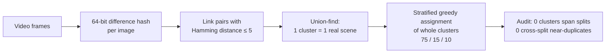

<!-- =====================================================================
     Unattended Luggage Detection — LuggageDataset v6i + enhanced YOLO models
     ===================================================================== -->

<p align="center">
  
  
  
</p>

<div align="center">

# Unattended Luggage Detection
### Enhanced YOLOv12s / YOLO26s models, a leakage-free benchmark, and an owner-aware alarm pipeline

<p>
  
  
  
  
  
  
</p>

**Constantin Catargiu · Iulian B. Ciocoiu**
<br/>Gheorghe Asachi Technical University of Iași, Romania

[**Dataset**](https://universe.roboflow.com/guns-detection-cvwjs/luggagedataset-24pgo/dataset/6) ·
[**Results**](#results) ·
[**Pipeline**](#unattended-luggage-pipeline) ·
[**Citation**](#citation)

</div>

---

## Overview

In fixed-camera surveillance, luggage is **small**: the camera is mounted high, looks down, and a bag occupies a fraction of a percent of the frame. Every later stage of an abandoned-object system — pairing a bag with its owner, timing the separation, raising the alarm — inherits whatever the detector misses. This repository accompanies the paper

> **Unattended Luggage Detection Using Enhanced YOLO Models and a Custom Dataset**
> C. Catargiu, I. B. Ciocoiu — *manuscript under review*

and provides:

| | |
|---|---|
| 🗂️ **LuggageDataset v6i** | 12,184 images · 57,814 annotated instances · 3 classes (backpack, bag, trolley) — about **21× more luggage annotations** than the largest previously available annotated in-domain set |
| 🧪 **Leakage-free evaluation** | near-duplicate frames are clustered before splitting, so no scene appears in both training and test |
| 🧠 **Enhanced detectors** | small-object–aware loss/assignment and architecture changes for **YOLOv12s** and **YOLO26s**, each verified to reproduce the pretrained baseline exactly at initialization |
| 📏 **Measured noise floor** | every reported configuration trained with **3 seeds**; gains are reported in units of seed-to-seed standard error |
| 🚨 **Unattended-luggage pipeline** | tracking, owner election and an occlusion-aware dwell clock — **5/5 abandonments detected, correct owner in 5/5, 0 false alarms** with the custom YOLOv12s |

### Headline results

| Detector | Small-object mAP@50 | F1 | Speed (RTX 4090) |
|---|---|---|---|
| YOLO26s baseline → **custom** | 77.26 → **79.91** (**+3.44%**) | 76.80 → **79.74** (+3.82%) | 341 → **295 FPS** |
| YOLOv12s baseline → **custom** | 77.65 → **79.87** (**+2.85%**) | 76.18 → **78.76** (+3.39%) | 247 → **120 FPS** |

Means over three seeds on the leakage-free test split; the gains are **9.5 SE** (YOLO26s) and **11.0 SE** (YOLOv12s) above the run-to-run noise.

---

## Contents

- [Dataset](#luggagedataset-v6i)
- [Method](#method)
- [Results](#results)
- [Unattended-luggage pipeline](#unattended-luggage-pipeline)
- [Key findings](#key-findings)
- [Getting started](#getting-started)
- [Citation](#citation)

---

## LuggageDataset v6i

<p align="center">
  
</p>

Images come from **fixed or quasi-static surveillance cameras** in transport hubs and indoor public spaces: elevated, oblique viewpoints; dense pedestrian traffic with frequent occlusion of a bag by its own owner; illumination from daylit concourses to artificially lit interiors; and all three classes co-occurring at very different scales in the same frame. **No augmentation is applied anywhere** — every number below is obtained on unmodified imagery.

### Composition

| Split | Images | Instances | Boxes / image |
|---|---:|---:|---:|
| Train | 9,138 (75%) | 41,823 (72.3%) | 4.58 |
| Validation | 1,827 (15%) | 9,819 (17.0%) | 5.37 |
| Test | 1,219 (10%) | 6,172 (10.7%) | 5.06 |
| **Total** | **12,184** | **57,814** | **4.75** |

Class shares are stable across splits — **trolley 50.7%, backpack 27.1%, bag 22.2%** — and the dominant resolution is 640×360 (80.4% of training images), typical of fixed-camera framing.

### Object size

The mean box is **39×55 px** in a 640-px frame (0.53% of the image area). Sizes binned by maximum side (32 / 64 px):

| Split | Small (< 32) | Medium (32–64) | Large (> 64) |
|---|---:|---:|---:|
| Train | 14,959 (35.8%) | 16,398 (39.2%) | 10,466 (25.0%) |
| Validation | 3,669 (37.4%) | 4,034 (41.1%) | 2,116 (21.6%) |
| Test | 2,175 (35.2%) | 2,510 (40.7%) | 1,487 (24.1%) |

Unlike the closest comparable public set, the dataset is **not devoid of large objects**, so it can reveal whether a small-object method gains by sacrificing large ones. Boxes are mostly tall (70.6% with h/w > 1.25); **bag** is the most heterogeneous class — widest, most balanced in shape, most bimodal in size — and the hardest to detect.

### Leakage-free split

Consecutive surveillance frames are near-identical, so a per-frame split puts the same scene in both training and test and partly measures memorization. The split is therefore built in two steps:



### Comparison with existing benchmarks

| Dataset | Content | Size | Annotations | Event labels |
|---|---|---|---|:---:|
| PETS 2006 | railway station, 4 views | 7 sequences | trigger frames + calibration | ✓ |
| i-LIDS AVSS 2007 | metro platform | 3 sequences | one event per sequence | ✓ |
| ABODA | indoor / outdoor / night | 11 videos | none | ✓ |
| IITP20 | 3 difficulty tiers | 58 videos | folder-level only | — |
| CCTV-KD | airport + walkway, bird's-eye | ~300 images | 2,760 luggage | — |
| **LuggageDataset v6i (ours)** | **fixed-camera public spaces** | **12,184 images** | **57,814 luggage, 3 classes** | — |

The dataset is detection-oriented and **complements** event benchmarks such as ABODA: it trains and evaluates the detector an event-level system is built on.

---

## Method

Both detectors are modified along two axes — **loss/assignment** and **architecture** — under one rule: *at initialization the modified model must reproduce the pretrained baseline exactly*. New blocks are residual branches with a zero-initialized gate, and the loss changes reduce to the original objective at their default values, so every comparison is controlled.

### Loss and assignment

| Detector | Modification | Idea |
|---|---|---|
| **YOLOv12s** | **Curriculum area weighting** | each positive is re-weighted by the inverse linear size of its box (A<sup>−1/2</sup>), with a 2× boost below 32 px; the weighting starts scale-dominant and decays to the standard score weighting by the end of training |
| **YOLO26s** | **Flattened alignment exponent** (β: 6 → 1) | on small objects one pixel moves IoU by several points; β = 6 amplifies that noise into the assigner's ranking and classification targets, β = 1 keeps the ranking but compresses the margins |

### Architecture

<p align="center">
  
</p>

Both models receive a **stride-4 (P2) detection level** with content-aware **DySample** upsampling — the one change that creates anchors where a small object has too few (a small instance goes from ~13 to ~52 candidate centers). Around it the two detectors differ:

- **YOLOv12s** — P2 branch *appended*; four detection levels, each with one gated refinement block: global context (average + max pooling) at stride 4, a **dynamic snake convolution** at strides 8/16/32.
- **YOLO26s** — P2 branch *inserted* into the PAN; the **stride-32 detection branch is removed** (the stride-32 backbone still feeds context), and the freed capacity deepens the two finest levels from 2 to 4 blocks — 27.7% fewer parameters.

---

## Results

All models: 70 epochs at 640×640 from the official pretrained checkpoints, mosaic disabled for the last 10 epochs, **three seeds per configuration**, evaluated on the full leakage-free test split (1,219 images, 6,172 instances). Hardware: NVIDIA RTX 4090.

### Main results (mean ± std over 3 seeds)

<table>
<tr><th rowspan="2">Metric</th><th colspan="3">YOLO26s</th><th colspan="3">YOLOv12s</th></tr>
<tr><th>Baseline</th><th>Custom</th><th>Δ</th><th>Baseline</th><th>Custom</th><th>Δ</th></tr>
<tr><td><b>mAP@50 (small)</b></td><td>77.26 ± 0.23</td><td><b>79.91 ± 0.42</b></td><td><b>+3.44%</b></td><td>77.65 ± 0.15</td><td><b>79.87 ± 0.29</b></td><td><b>+2.85%</b></td></tr>
<tr><td>mAP@50</td><td>80.25 ± 0.29</td><td>83.01 ± 0.39</td><td>+3.45%</td><td>80.72 ± 0.20</td><td>82.60 ± 0.21</td><td>+2.32%</td></tr>
<tr><td>mAP@50-95</td><td>54.90 ± 0.18</td><td>56.43 ± 0.18</td><td>+2.79%</td><td>54.75 ± 0.15</td><td>56.09 ± 0.21</td><td>+2.44%</td></tr>
<tr><td>Precision</td><td>81.28 ± 0.32</td><td>84.00 ± 0.31</td><td>+3.35%</td><td>80.60 ± 0.30</td><td>83.00 ± 0.29</td><td>+2.97%</td></tr>
<tr><td>Recall</td><td>72.79 ± 0.19</td><td>75.89 ± 0.31</td><td>+4.25%</td><td>72.23 ± 0.42</td><td>74.94 ± 0.39</td><td>+3.76%</td></tr>
<tr><td>F1</td><td>76.80 ± 0.25</td><td>79.74 ± 0.24</td><td>+3.82%</td><td>76.18 ± 0.27</td><td>78.76 ± 0.35</td><td>+3.39%</td></tr>
</table>

### Contribution of each axis — small-object mAP@50

| Detector | Baseline | + Loss | + Architecture | **Both** |
|---|---:|---:|---:|---:|
| YOLO26s | 77.26 | 78.61 | 79.83 | **79.91** |
| YOLOv12s | 77.65 | 77.93 | 78.79 | **79.87** |

The loss axis alone **trades localization for detection** (mAP@50-95 −0.35% on YOLO26s, −0.37% on YOLOv12s); the architecture improves both, and the combination is best on the primary metric for both detectors.

<p align="center">
  
  <br/><sub>YOLO26s per-epoch validation metrics for the four configurations (baseline, loss only, architecture only, both).</sub>
</p>

### Statistical rigor

- **Noise floor:** pooled within-configuration standard deviation σ = 0.34% (YOLO26s) and 0.25% (YOLOv12s); a difference between two three-seed means has SE = 0.28% and 0.20%. A gain counts as resolved above 2 SE.
- **Selection bias:** re-running configurations that won an exploratory round regressed by −0.55% on average — so single-draw maxima are never reported as results.
- **No per-cell maxima:** each table column is one configuration evaluated at all sizes, not the best run per cell.

### Cross-detector transfer

Each modification evaluated on its own detector and on the other one (change in small-object mAP@50 over that detector's baseline; < ~0.7% is not resolvable):

| Axis | Modification | Own | Other |
|---|---|---:|---:|
| Loss | Curriculum area weighting (YOLOv12s) | +0.36 | null |
| Loss | Alignment exponent β = 1 (YOLO26s) | **+1.75** | +0.32 |
| Architecture | Level-specific blocks (YOLOv12s) | **+1.47** | +0.66 |
| Architecture | Drop stride 32 + depth 4 (YOLO26s) | **+3.33** | +0.56 |

**Nothing transfers.** Each mechanism depends on an implementation detail the configuration surface hides — DFL vs. an image-normalized L1 term, NMS vs. one-to-one assignment, the topology of the branch it deepens. A small-object method validated on one detector should not be assumed to carry to another, even within the same family.

### Inference speed

RTX 4090, batch 1, 640×640, FP16, median over 500 test images (pre- and post-processing included):

| Model | GFLOPs | Latency | FPS |
|---|---:|---:|---:|
| YOLOv12s baseline | 19.3 | 4.05 ms | 247 |
| YOLOv12s custom | 32.1 | 8.32 ms | 120 |
| YOLO26s baseline | 20.5 | 2.93 ms | 341 |
| **YOLO26s custom** | **23.5** | **3.39 ms** | **295** |

On the surveillance clips (5,683 frames), even the slowest detector — custom YOLOv12s — runs at **109 FPS including video decoding**, 3.5–3.9× faster than real time. The custom YOLO26s reaches the same small-object accuracy as the custom YOLOv12s at **~2.5× its frame rate**.

<p align="center">
  
  <br/><sub>Custom YOLO26s, row-normalized confusion matrices on the test split (all objects and per size). <b>Bag</b> remains the hardest class at every size.</sub>
</p>

---

## Unattended-luggage pipeline

<p align="center">
  
</p>

The alarm rule is the conventional one — a bag becomes unattended when its owner is farther than a threshold, and raises an alarm after a dwell time. What makes it work in a crowd is **keeping the identities it depends on**:

- **Identity** — boxes matched by certainty (mutual best overlaps, then Hungarian assignment); partial detections of a hidden person are given only to that person; lost identities are recovered with **OSNet** re-identification.
- **Ownership** — *the owner is a person, not a track number*. Walking **with** a bag is strong evidence, standing near it is weak; the owner is elected after the bag's first 2 s, and afterwards only someone seen carrying the bag can take it over.
- **Alarm** — distances are in person-heights *h* (≈ 1.7 m), so one threshold holds near and far from the camera. A bag is unattended when its owner is > 2.5 *h* away (or hidden for 4 s); the alarm latches after 10 s, and the clock runs only while the bag itself is visible.

| Parameter | Value |
|---|---|
| Owner / away / return radius | 1.5 *h* / 2.5 *h* / 2.0 *h* |
| Election / dwell / grace / return | 2 s / 10 s / 4 s / 1.5 s |

### Evaluation on AVSS 2007 and ABODA

Five clips (i-LIDS AVSS 2007 easy and medium; ABODA videos 1, 9, 10), four luggage detectors, parameters set on the medium clip only and run unchanged on the other four:

| | YOLOv12s official | **YOLOv12s custom** | YOLO26s official | YOLO26s custom |
|---|:---:|:---:|:---:|:---:|
| Alarms on the abandoned bag | 5/5 | **5/5** | 4/5 | 4/5 |
| Correct owner named | 4/5 | **5/5** | 2/4 | 3/4 |
| False alarms | 0 | **0** | 0 | 0 |

<p align="center">
  
  <br/><sub>Share of frames in which each detector finds the abandoned bag (a) while carried and (b) while unattended. Panel (b) decides whether the alarm fires; panel (a) whether the right owner is named.</sub>
</p>

**The tracking logic is not the bottleneck — small-luggage detection is.** Every run that found the standing bag in more than half of the unattended frames raised the alarm; the single missed event (ABODA video9, both YOLO26s detectors) is a detection failure, not a logic failure. Naming the right owner depends on detecting the bag *while it is carried*: 91% of frames for the custom YOLOv12s against 62–77% for the others.

<details>
<summary><b>Example: ABODA video1 — all four detectors on the same frames</b></summary>
<p align="center">
  
</p>
Two men enter together and one carries the bag. The official detectors elect the companion; the custom detectors elect the man actually carrying the bag.
</details>

---

## Key findings

1. **Small-object gains are real and measurable** — +3.44% (YOLO26s) and +2.85% (YOLOv12s) small-object mAP@50, many times the measured seed-to-seed noise.
2. **The two axes behave differently** — the loss/assignment change trades localization for detection; the architectural change improves both.
3. **Mechanisms do not transfer between detectors** — all four cross-detector transfers are null on the primary metric; implementation details decide.
4. **YOLO26s offers the best accuracy–speed trade-off** — same small-object accuracy as custom YOLOv12s at ~2.5× the frame rate, with 27.7% fewer parameters.
5. **Detection is the bottleneck of event-level systems** — the small-object gains are exactly what the abandonment pipeline consumes.

---

## Getting started

### Download the dataset

```python
# pip install roboflow
from roboflow import Roboflow

rf = Roboflow(api_key="YOUR_API_KEY")
project = rf.workspace("guns-detection-cvwjs").project("luggagedataset-24pgo")
dataset = project.version(6).download("yolov8")   # YOLO format, train / valid / test
```

### Train and evaluate a baseline

```python
# pip install ultralytics
from ultralytics import YOLO

model = YOLO("yolo26s.pt")                          # or "yolo12s.pt"
model.train(data=f"{dataset.location}/data.yaml", epochs=70, imgsz=640, close_mosaic=10)
metrics = model.val(data=f"{dataset.location}/data.yaml", split="test")
```

The code for the leakage-free split, the custom loss/assignment and architectural modules, training and evaluation is provided in this repository.

---

## Citation

If you use LuggageDataset v6i or this code, please cite:

```bibtex
@article{catargiu2026luggage,
  title   = {Unattended Luggage Detection Using Enhanced YOLO Models and a Custom Dataset},
  author  = {Catargiu, Constantin and Ciocoiu, Iulian B.},
  journal = {Manuscript under review},
  year    = {2026}
}
```

The leakage-free splitting procedure and the curriculum area weighting were introduced in our earlier work:

```bibtex
@article{catargiu2026weapon,
  title   = {Real-Time Weapon Detection Using Enhanced YOLO12 Models and a Custom Dataset},
  author  = {Catargiu, Constantin and Ciocoiu, Iulian B.},
  journal = {IEEE Access},
  volume  = {14},
  year    = {2026},
  doi     = {10.1109/ACCESS.2026.3721157}
}
```

---

## License

Released under the **MIT License**. Event-level evaluation uses the public i-LIDS AVSS 2007 and ABODA sequences, which remain subject to their own terms.

## Contact

**Constantin Catargiu** — constantin.catargiu95@gmail.com
**Prof. Iulian B. Ciocoiu** (corresponding author) — iciocoiu@etti.tuiasi.ro
Gheorghe Asachi Technical University of Iași, Bd. Carol I no. 11A, 700506 Iași, Romania
