# Figures

Figures of the paper, in order. Captions as in the manuscript.

## Figure 1

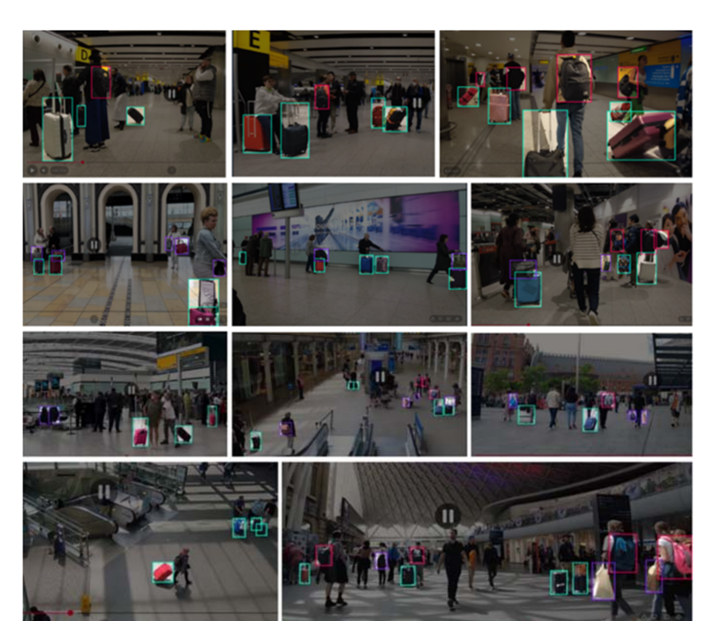

Examples of annotated frames from LuggageDataset v6i.

## Figure 2

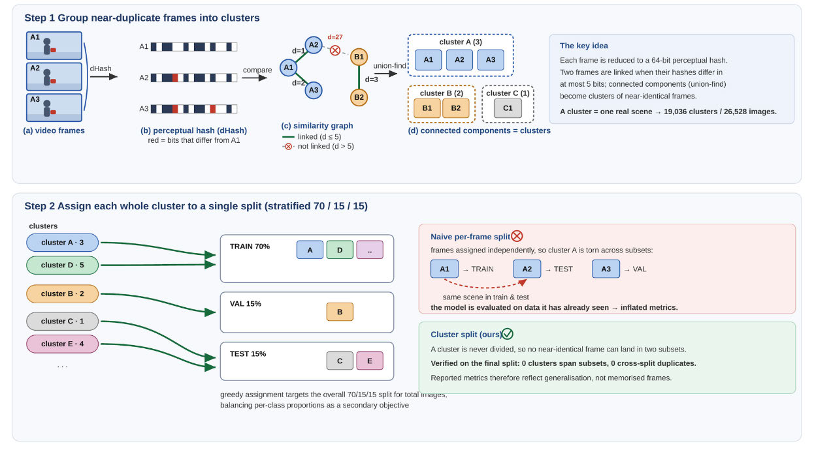

The leakage-free splitting procedure. Step 1: each frame is reduced to a 64-bit perceptual (difference) hash; any two frames whose hashes differ in at most five bits are linked, and connected components extracted by union-find group mutually near-identical frames into clusters, so that one cluster corresponds to one real scene. Step 2: each whole cluster is assigned to a single split by a stratified greedy procedure, so no near-duplicate frame can cross a split boundary by construction.

## Figure 3

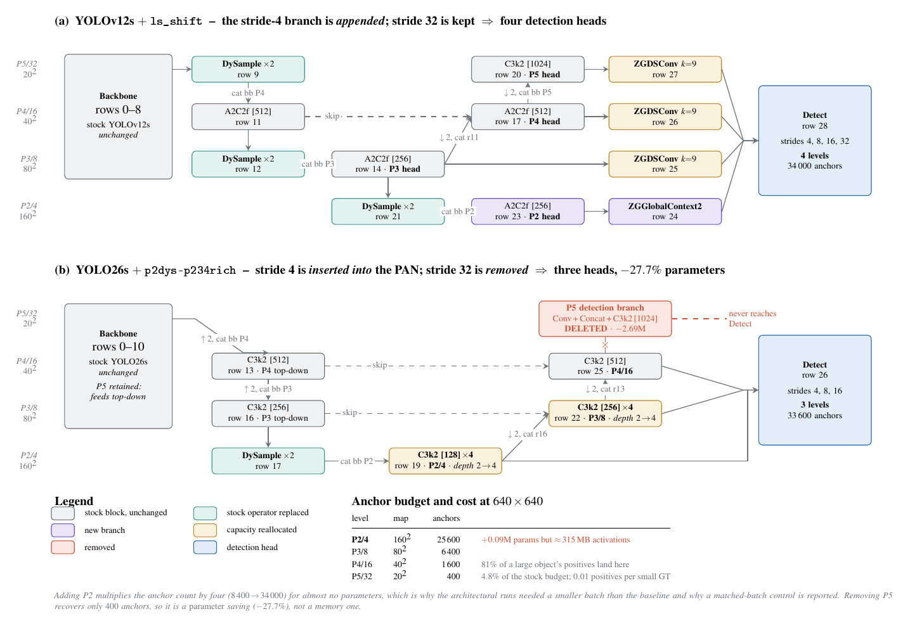

The two architectural modifications. The vertical axis is the pyramid level, and the horizontal axis is depth through the network; solid arrows are the main data path, dashed arrows are lateral skips, and Conv-downsample and Concat rows are folded into the edge labels so that only tensor-producing blocks are drawn. (a) on YOLOv12s the stride-4 branch is appended: the existing top-down/bottom-up path (rows 9–20) is left intact, a P2 head is built from row 14 by content-aware upsampling, and each of the four levels then receives one gated refinement block — global context where the small objects are, a directional snake kernel where the medium and large ones are. (b) on YOLO26s the stride-4 branch is inserted into the PAN, and the bottom-up path is rebuilt through it (row 19 → 22 → 25), the two finest levels are deepened from two blocks to four, and the stride-32 detection branch is deleted while the stride-32 backbone is retained to feed the top-down path. Every colored block is gated as in Equation (8), so at initialization both networks reproduce their pretrained baseline exactly.

## Figure 4

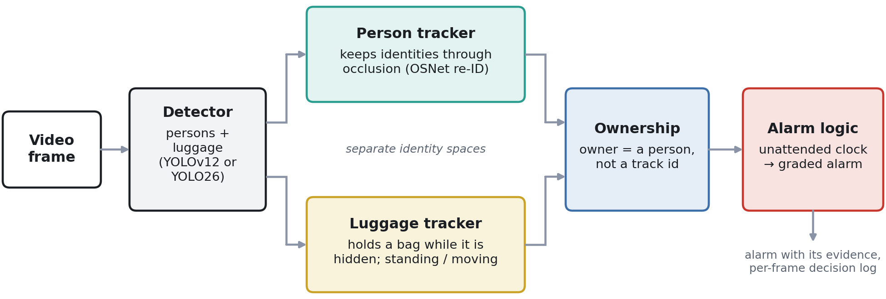

The unattended-luggage pipeline. A YOLOv12 or YOLO26 detector provides person and luggage boxes in every frame, tracked in separate identity spaces so that the two never share a numbering. The ownership stage binds each bag to a person rather than to a track number, and the alarm logic runs one dwell clock per bag. Every decision is written to a per-frame log, so a raised alarm can be replayed against the evidence that produced it. Only the luggage detector is fine-tuned on our data; the person detector is a pre-trained COCO model.

## Figure 5

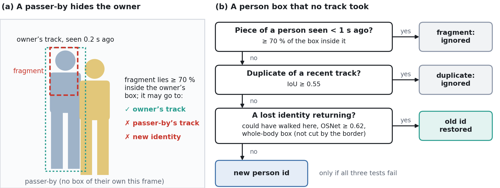

The two rules that keep a person’s number through a crossing. (a) A passer-by hides a person and only part of the hidden person is detected; the piece lies inside that person’s recent box, so only their track may take it. (b) A box that no track took is tested three times before it is allowed to become a new person.

## Figure 6

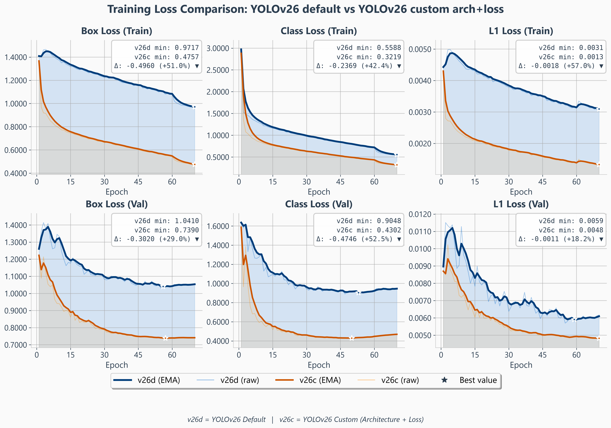

YOLO26s loss components, default (v26d) versus the custom configuration (v26c): raw and smoothed per-epoch traces (smoothed in bold), with the best value starred.

## Figure 7

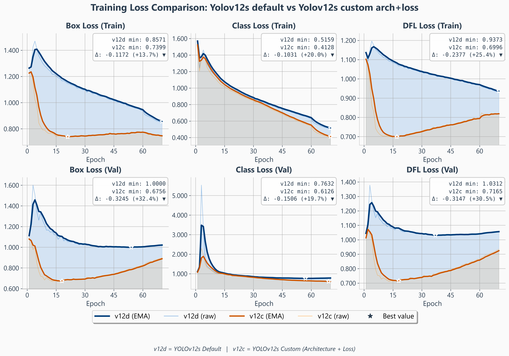

YOLOv12s loss components, default (v12d) versus the custom configuration (v12c): raw and smoothed per-epoch traces (smoothed in bold), with the best value starred.

## Figure 8

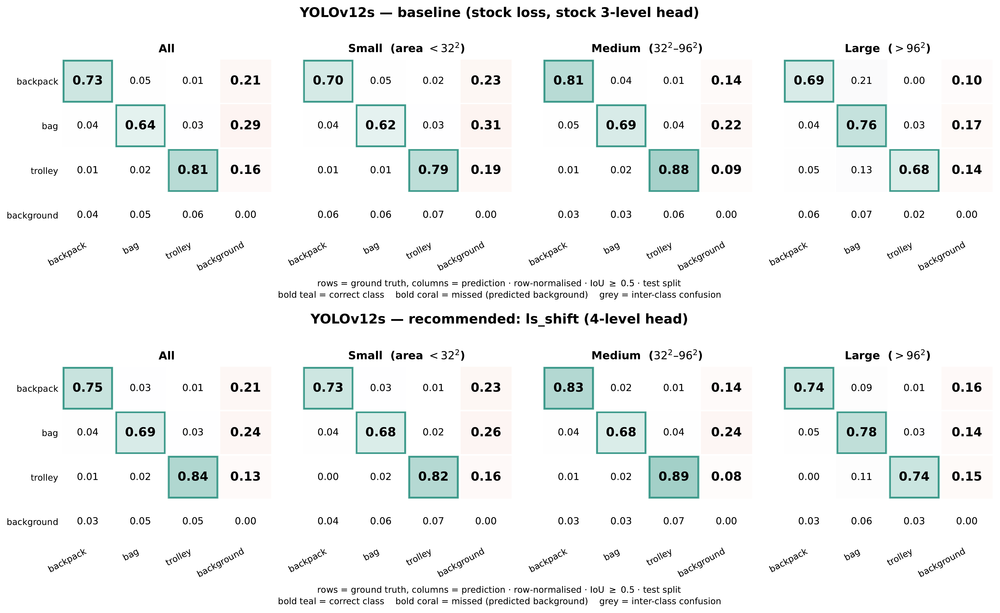

YOLOv12s confusion matrices on the test split, row-normalized, for all objects and per size: baseline (top) and custom configuration (bottom).

## Figure 9

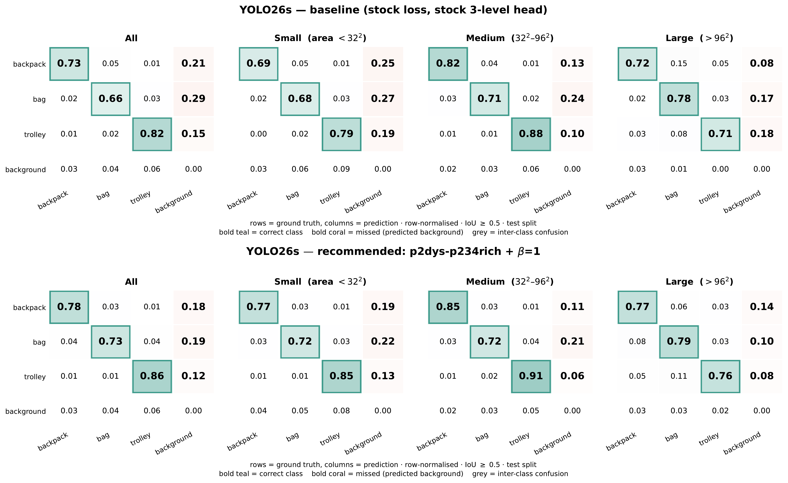

YOLO26s confusion matrices on the test split, row-normalized, for all objects and per size: baseline (top) and custom configuration (bottom).

## Figure 10

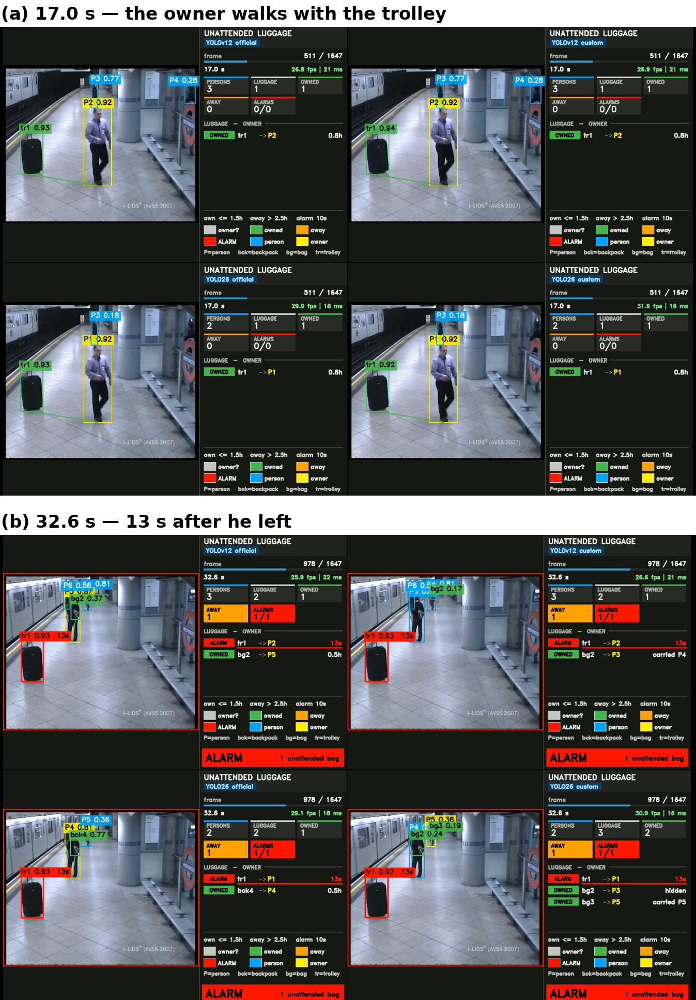

AVSS 2007 easy clip, the four detectors on the same frames (top: YOLOv12s official | YOLOv12s custom; bottom: YOLO26s official | YOLO26s custom). (a) 17.0 s: the owner walks with the trolley and all four runs pair it with him. (b) 32.6 s, 13 s after he left: the same alarm, the same owner and practically the same clock in all four runs.

## Figure 11

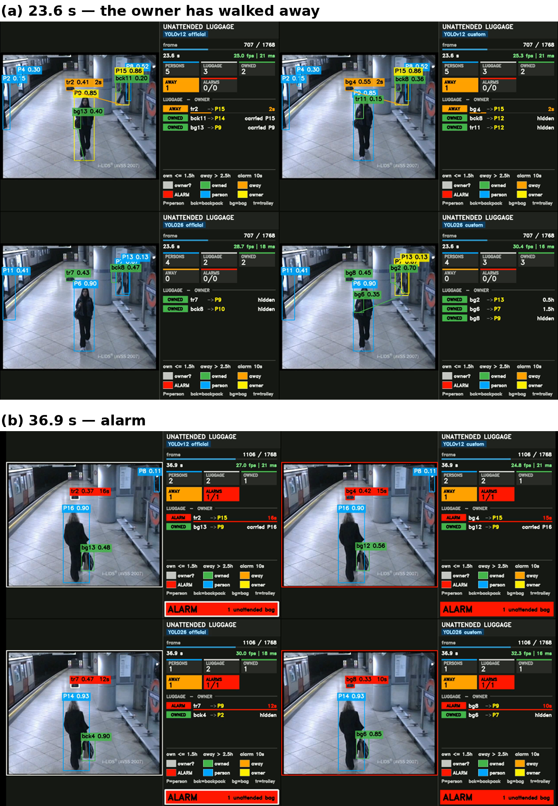

AVSS 2007 medium clip, layout as in Figure 10. (a) 23.6 s: the owner (P15) has walked away from the trolley. Both YOLOv12s runs have started the clock (orange, 2 s); both YOLO26s runs have given the trolley to a passenger (P9) who is out of view, so no clock runs at all. (b) 36.9 s: all four runs are in alarm on the trolley, but the YOLO26s runs name the passenger, and their clocks lag (12 s and 10 s against 16 s and 15 s) because the clock starts when that run’s elected owner is seen leaving.

## Figure 12

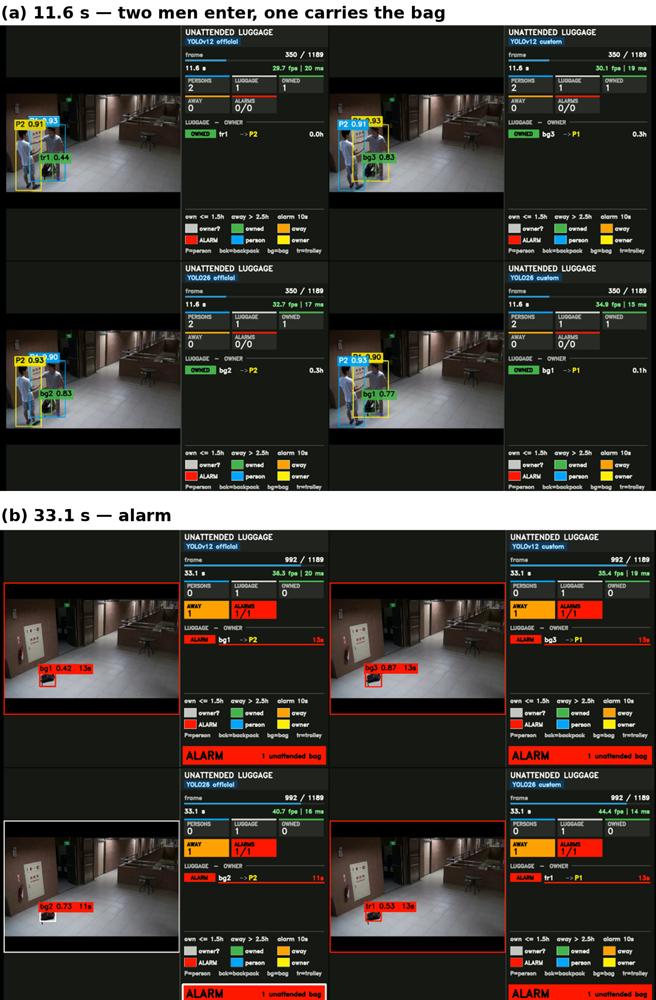

ABODA video1, layout as in Figure 10. (a) 11.6 s: two men enter together and one carries the bag. YOLOv12s official finds it at 0.44 and as a trolley; the two official runs have elected the companion (P2), the two custom runs the man actually carrying the bag (P1). (b) 33.1 s: all four raise the alarm on the right bag, two of them naming the companion.

## Figure 13

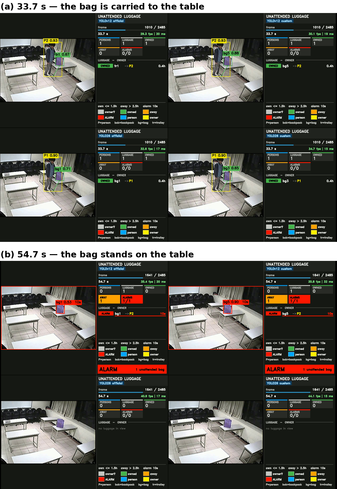

ABODA video9, layout as in Figure 10. (a) 33.7 s: all four runs detect the bag while its owner carries it to the table. (b) 54.7 s: both YOLOv12 runs raise the alarm; neither YOLO26s run detects the bag once it stands still on the table (“no luggage in view”), so no alarm is possible. This is the single missed event, and it is a detection failure rather than a logic failure.

## Figure 14

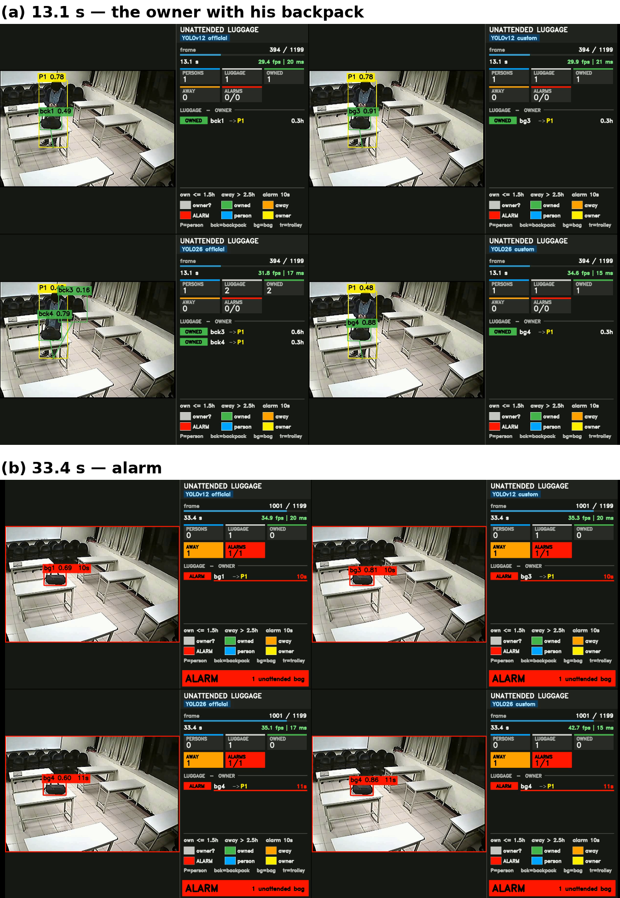

ABODA video10, layout as in Figure 10. (a) 13.1 s: all four runs detect the backpack and its owner; YOLO26s official adds a spurious second backpack (bck3, a backpack track detected with confidence 0.16) and scores the owner at 0.48 against 0.78 for YOLOv12s. (b) 33.4 s: the same alarm, owner and clock in all four runs.

## Figure 15

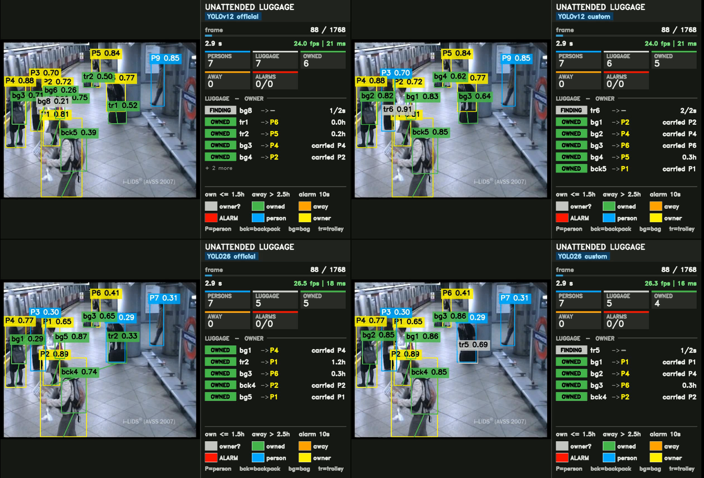

AVSS 2007 medium clip at 2.9 s, the crowd on the platform, layout as in Figure 10. The YOLOv12s detectors find 7 and 6 bags, the YOLO26s detectors 5 each, and the YOLO26s person model scores the same people lower (e.g., 0.30 against 0.70) — the mechanism behind its 72% owner-detection rate on this clip in Table 11.

## Figure 16

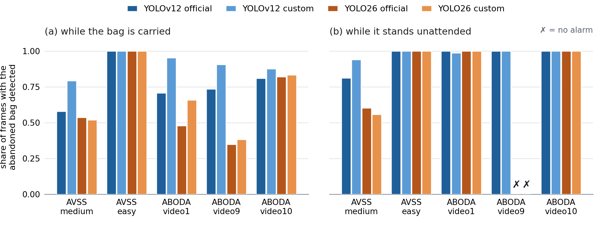

Share of frames in which each detector found the abandoned bag, (a) while it is carried by its owner and (b) while it stands unattended. ×: no alarm. Panel (b) decides whether the alarm fires at all; panel (a) decides whether the owner named with it is the right person.
