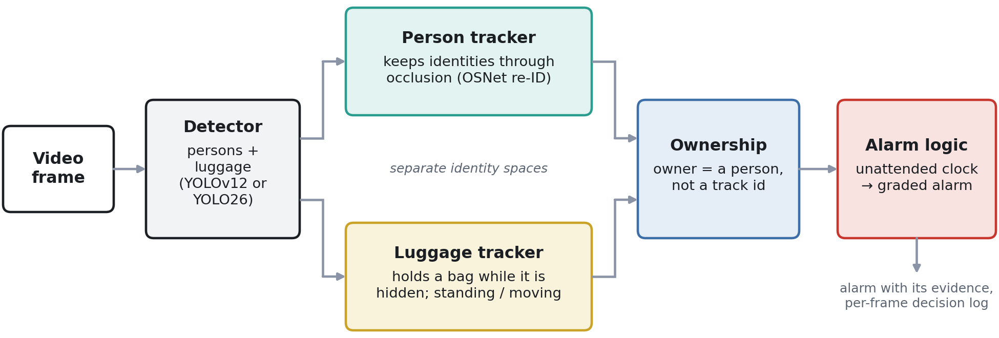

# 🚨 Unattended-luggage pipeline

The event-level system of the paper (Section 6 of the main README): a luggage detector and a person detector run on every frame, each feeding its own tracker; every bag is bound to an **owner — a person, not a track number** — and an alarm fires when that owner stays away for **10 s** of video time.

<p align="center">
  
</p>

## Files

| File | What it does |
|---|---|
| [`unattended_luggage.py`](unattended_luggage.py) | The pipeline: detection, person / luggage tracking, OSNet re-identification, ownership, alarm logic, annotated video + logs |
| [`person_reid.py`](person_reid.py) | OSNet (x1.0, MSMT17) person re-identification; downloads its weights on first use |
| [`reid_thresholds.json`](reid_thresholds.json) | Re-ID similarity thresholds calibrated on the development clip (OSNet AUC 0.923 vs 0.749 for a colour histogram) |
| [`make_grid_videos.py`](make_grid_videos.py) | Combines the four detector outputs of a clip into one 2 × 2 comparison video (the layout of Figures 10–15) |

## Setup

1. **Environments** — the YOLOv12 profiles run in **Environment A**, the YOLO26 profiles in **Environment B** (see *Installation* in the main README). Extra packages: `pip install scipy opencv-python gdown` (`gdown` only fetches the OSNet weights once).
2. **Luggage detectors** — the released checkpoints in `weights/` (from the [Release](../../../releases/latest)):

   | Profile | Luggage detector | Persons | Env |
   |---|---|---|:---:|
   | `yolov12-official` | `weights/yolov12s_default.pt` | `yolov12x.pt` (official COCO) | A |
   | `yolov12-custom` | `weights/yolov12s_lsshift_sqrt.pt` | `yolov12x.pt` (official COCO) | A |
   | `yolo26-official` | `weights/yolo26s_default.pt` | `yolo26x.pt` (official COCO) | B |
   | `yolo26-custom` | `weights/yolo26s_p234rich_beta1.pt` | `yolo26x.pt` (official COCO) | B |

   Only the luggage detector differs between *official* and *custom*; persons always come from the official model of the same family. Edit `MODEL_PROFILES` at the top of the script to use other weights.
3. **Videos** — put the clips in `videos/` at the repository root:
   - **ABODA** videos 1, 9 and 10 — https://github.com/kevinlin311tw/ABODA → `videos/video1.avi`, `videos/video9.avi`, `videos/video10.avi`
   - **i-LIDS AVSS 2007** *medium* (the development clip) and *easy* → `videos/AVSS07_medium.mpg`, `videos/AVSS07_easy.mpg` — distributed separately under their own terms

   Any other fixed-camera video works as well; pass its path on the command line.

## Run

From the repository root:

```bash
# one clip, one detector
python pipeline/unattended_luggage.py --model yolov12-custom videos/video1.avi          # Environment A
python pipeline/unattended_luggage.py --model yolo26-custom  videos/video1.avi          # Environment B

# all five clips (TEST_VIDEOS) with both profiles of one family, plus a summary table
python pipeline/unattended_luggage.py --all --models yolov12-official,yolov12-custom    # Environment A
python pipeline/unattended_luggage.py --all --models yolo26-official,yolo26-custom      # Environment B

# then the 2x2 comparison videos
python pipeline/make_grid_videos.py
```

A preview window opens while a single clip runs (keys: `q` quit, `space` pause, `s` screenshot); add `--no-show` on a machine without a display. `DEVICE` at the top of the script selects the GPU (`"0"`) or `"cpu"`.

## Outputs

| Output | Where |
|---|---|
| Annotated video | next to the input: `videos/<clip>_<profile>_output.mp4` |
| Alarm events | `runs_pipeline/<clip>__<profile>__<time>/events.json` |
| Full per-frame decision log | `runs_pipeline/…/trace.jsonl` — every detection, association, ownership and alarm decision (`pandas.read_json(path, lines=True)`) |
| Batch summary (with `--all`) | `runs_pipeline/batch_<time>.csv` — alarms, first-alarm time, owner, confidence, identity counts per run |
| 2 × 2 comparison | `videos/<clip>_grid_2x2.mp4` |

## How it decides (summary)

- **Time is video time** — timers advance by 1/fps per frame, so every run is reproducible on any machine.
- **Distance is in person-heights** — feet-to-bag-base distance divided by the person's box height (1 h ≈ 1.7 m anywhere in the image).
- **Owner = a person** — elected over the bag's first 2 s by a decaying score that rewards *walking with* the bag; afterwards only someone seen carrying it can take it over. Verification, split and newborn-only hand-over rules keep the owner when track numbers change.
- **Identities survive gaps** — weak detections keep tracks alive (never start them), a fragment inside a recent person box goes only to that person, lost people are revived with OSNet for up to 26 s.
- **Alarm** — owner farther than 2.5 h (or hidden 4 s after being seen near the bag) starts the clock; 10 s with the bag visible raises a latched alarm; a return must hold within 2.0 h for 1.5 s to reset it.

All thresholds are named constants at the top of `unattended_luggage.py`; the values are those of the paper (main README §6.3). They were tuned on the AVSS 2007 medium clip only; the other four clips were run unchanged.
